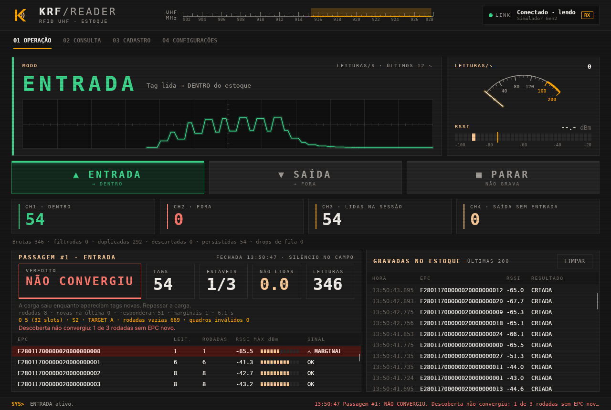
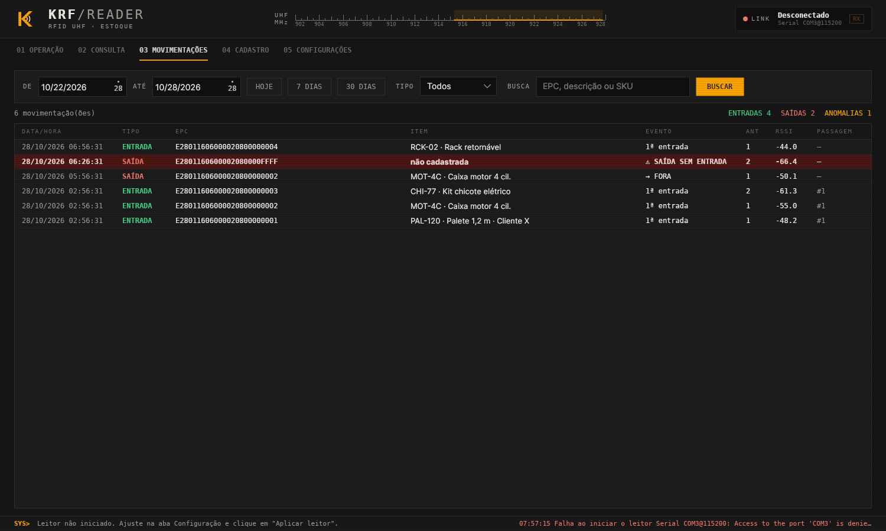
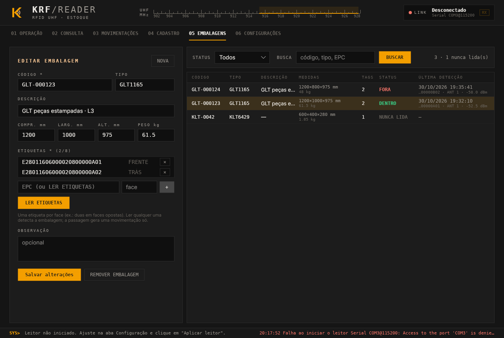
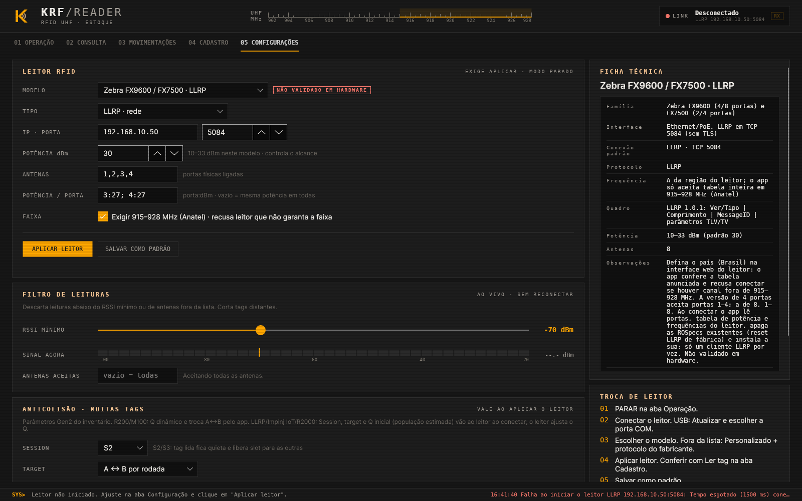
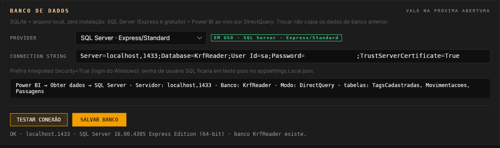
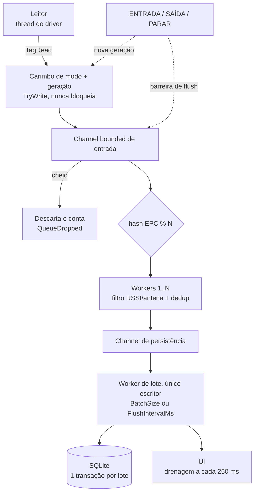

<div align="center">
  

  <h1>《 KRF Reader — Controle de entrada e saída de estoque por RFID UHF 》</h1>

  <p>Aplicação desktop em C# / .NET 8 com interface Avalonia 11. Lê tags RFID UHF num portal (doca, porta de almoxarifado), aplica a direção escolhida pelo operador e mantém o status de cada tag em SQLite ou SQL Server (Power BI ao vivo por DirectQuery). O driver do leitor é desacoplado do fabricante.</p>

  <p>
    
    
    
    
    
    
  </p>
</div>

> [!WARNING]
> O app não tem modo simulado: ele sobe conectando no leitor **R200** (COM3, 115200, 915–928 MHz). Com o R200 real
> foram validados identificação, potência, região/canais, início e parada do inventário. **A leitura de tags com
> hardware real nunca foi validada**: o leitor foi testado sem antena. O pipeline foi coberto por 403 testes
> automatizados, que usam um simulador que só existe no projeto de testes.
> Os drivers de leitores industriais (**LLRP** para Impinj R700/Speedway e Zebra FX9600/FX7500, **Impinj IoT REST**
> para o R700, **R2000 multiporta** para Chafon CF-RU5106 e similares) seguem as especificações publicadas e foram
> testados só contra leitores falsos no projeto de testes. **Nenhum deles foi validado em hardware.**
> UHF lê fora da zona de interesse; o software mitiga leituras fantasma, mas não resolve. Leia
> [Limitações físicas do UHF](#limitações-físicas-do-uhf) antes de instalar.

## Sumário

- [Sobre o Repositório](#sobre-o-repositório)
- [Módulos](#módulos)
  - [Mapa do código](#mapa-do-código)
- [Projeto](#projeto)
  - [Interface gráfica](#interface-gráfica)
  - [Regras de negócio](#regras-de-negócio)
  - [Cadastro de tags](#cadastro-de-tags)
  - [Embalagens com várias etiquetas](#embalagens-com-várias-etiquetas)
  - [Banco de dados](#banco-de-dados)
  - [Power BI em tempo real](#power-bi-em-tempo-real)
  - [Pipeline de leituras](#pipeline-de-leituras)
  - [Leitura de muitas tags (passagem)](#leitura-de-muitas-tags-passagem)
  - [Leitor real](#leitor-real)
  - [Novo driver](#novo-driver)
  - [Trocar o banco](#trocar-o-banco)
  - [Limitações físicas do UHF](#limitações-físicas-do-uhf)
- [Tecnologias](#tecnologias)
- [Como Rodar](#como-rodar)
  - [Requisitos](#requisitos)
  - [Build, testes e publish](#build-testes-e-publish)
  - [Configuração](#configuração)
  - [Testes](#testes)
  - [Contribuição](#contribuição)
- [Decisões e Desafios](#decisões-e-desafios)

## Sobre o Repositório

O **KRF Reader** controla entrada e saída de estoque num portal RFID UHF. O operador escolhe a direção do fluxo:

- **ENTRADA:** toda tag lida fica `DENTRO`.
- **SAÍDA:** toda tag lida fica `FORA`.
- **PARAR:** encerra o inventário e grava o que já foi lido no modo vigente.

A tag carrega apenas o EPC. Toda a lógica de estoque fica no sistema e no banco. Não há servidor, nuvem ou
telemetria: o app fala só com o leitor (serial ou TCP) e com o banco: SQLite local (padrão) ou SQL Server
(opcional, para o Power BI ler ao vivo).

## Módulos

| Módulo | Entrega | Descrição |
| --- | --- | --- |
| Interface | `KrfReader.UI` | Avalonia 11 (MVVM): abas Operação, Consulta, Cadastro e Configuração. Composition root e `appsettings.json`. |
| Domínio | `KrfReader.Domain` | Regra pura (`InventoryRules.Decide`, `TagRegistrationRules`), enums, `TagRead`, `Epc`. Sem dependências. |
| Aplicação | `KrfReader.Application` | Contratos (`IRfidReader`, `IReaderProtocol`, `IInventoryRepository`, `ITagCatalogRepository`, `IInventoryPipeline`), options e pipeline concorrente. |
| Infraestrutura | `KrfReader.Infrastructure` | Drivers de leitor (Serial, TCP), protocolos plugáveis e repositórios SQLite e SQL Server. |
| Testes | `tests/KrfReader.Tests` | xUnit: domínio, dedup, troca de modo, idempotência, anomalia, SQLite e SQL Server (mesma suíte), parser, ponta a ponta. |

### Mapa do código

```text
KRF-Reader/
├── KrfReader.sln
├── Directory.Build.props              # net8.0, nullable, implicit usings
├── Directory.Packages.props           # versões centralizadas (Avalonia 11.3.22, Dapper, Sqlite, SqlClient)
├── db/migrations/                     # NNNN_nome.sql: migrações SQLite (embutidas e aplicadas no start)
│   └── sqlserver/                     # NNNN_nome.sql: migrações SQL Server (sequência própria)
├── docs/screenshots/                  # telas usadas neste README
├── src/
│   ├── KrfReader.Domain/              # InventoryRules, TagRegistration, Package, Epc, TagRead, TagState, InventoryEvent, DbLiterals
│   ├── KrfReader.Application/
│   │   ├── Configuration/             # ReaderOptions (+ Inventory), PipelineOptions, PassageOptions, DatabaseOptions
│   │   ├── Persistence/               # IInventoryRepository, ITagCatalogRepository, IPackageCatalogRepository
│   │   ├── Pipeline/                  # InventoryPipeline, Deduplicator, ReadFilter, ModeState, PassageTracker, PassageMonitor, PackageDirectory
│   │   └── Readers/                   # IRfidReader, IReaderProtocol, IRfidReaderFactory, InventoryTuning (Gen2), RadioSetup (portas, Anatel)
│   ├── KrfReader.Infrastructure/
│   │   ├── Persistence/               # Sqlite/SqlServerInventoryRepository, BatchPlanner, migradores
│   │   └── Readers/                   # GenericSerialReader, GenericTcpReader, Protocols/ (R200/M100, R2000, AsciiLine),
│   │                                  # Llrp/ (cliente LLRP 1.0.1), ImpinjIot/ (REST do R700)
│   └── KrfReader.UI/                  # App, MainWindow, ViewModels, CompositionRoot, Assets
└── tests/KrfReader.Tests/             # Domain, Pipeline, Persistence, Readers, Integration, Fakes
```

| Arquivo | Responsabilidade |
| --- | --- |
| [Domain/InventoryRules.cs](src/KrfReader.Domain/InventoryRules.cs) | Decide o novo status e o evento a partir do status atual e do modo. Função pura. |
| [Domain/Epc.cs](src/KrfReader.Domain/Epc.cs) | Normaliza e valida o EPC. |
| [Domain/TagRegistration.cs](src/KrfReader.Domain/TagRegistration.cs) | Cadastro de tag e validação (EPC Gen2, descrição obrigatória). |
| [Domain/Package.cs](src/KrfReader.Domain/Package.cs) | Embalagem com várias etiquetas e validação (código, tipo, medidas, peso, 1–8 EPCs). |
| [Pipeline/InventoryPipeline.cs](src/KrfReader.Application/Pipeline/InventoryPipeline.cs) | Channels de entrada e persistência, workers particionados por EPC, lote, barreira de PARAR e shutdown. |
| [Pipeline/ModeState.cs](src/KrfReader.Application/Pipeline/ModeState.cs) | Modo atual e geração; carimba cada leitura na chegada. |
| [Pipeline/Deduplicator.cs](src/KrfReader.Application/Pipeline/Deduplicator.cs) | Ignora a mesma tag na mesma geração dentro de `DedupWindowSeconds`. |
| [Pipeline/ReadFilter.cs](src/KrfReader.Application/Pipeline/ReadFilter.cs) | Filtro de RSSI mínimo e antenas aceitas. |
| [Readers/StreamRfidReaderBase.cs](src/KrfReader.Infrastructure/Readers/StreamRfidReaderBase.cs) | Base de serial/TCP: transporte, reconexão e threading. |
| [Readers/Protocols/AsciiLineProtocol.cs](src/KrfReader.Infrastructure/Readers/Protocols/AsciiLineProtocol.cs) | Parser `EPC,RSSI,ANTENA[,TIMESTAMP]` com frames parciais. |
| [Readers/Protocols/R2000Protocol.cs](src/KrfReader.Infrastructure/Readers/Protocols/R2000Protocol.cs) | Quadros `A0` do R2000: 0x89 (uma porta) ou 0x8A (troca rápida, até 4), potência por porta, região 915,5–927,5 MHz. |
| [Readers/Llrp/LlrpReader.cs](src/KrfReader.Infrastructure/Readers/Llrp/LlrpReader.cs) | Driver LLRP: capacidades, checagem Anatel, ROSpec própria, keepalive, reconexão. |
| [Readers/Llrp/LlrpProtocol.cs](src/KrfReader.Infrastructure/Readers/Llrp/LlrpProtocol.cs) | Montagem e leitura das mensagens LLRP (ROSpec, relatórios, capacidades, tabela de potência). |
| [Readers/ImpinjIot/ImpinjIotReader.cs](src/KrfReader.Infrastructure/Readers/ImpinjIot/ImpinjIotReader.cs) | R700 pela IoT Device Interface: preset por porta, canais Anatel, fluxo NDJSON. |
| [Readers/ReaderModelCatalog.cs](src/KrfReader.Infrastructure/Readers/ReaderModelCatalog.cs) | Catálogo de modelos exibido em CONFIGURAÇÕES. |
| [Fakes/MockReader.cs](tests/KrfReader.Tests/Fakes/MockReader.cs) | Simulador usado só nos testes: população de tags, entrada e saída do campo, rajadas e leituras fantasma. |
| [Persistence/SqliteInventoryRepository.cs](src/KrfReader.Infrastructure/Persistence/SqliteInventoryRepository.cs) | Aplica o lote numa transação: carrega estado, decide, faz upsert e insere eventos. |
| [Persistence/SqliteInventoryRepository.Catalog.cs](src/KrfReader.Infrastructure/Persistence/SqliteInventoryRepository.Catalog.cs) | CRUD de `TagCadastro` e consulta de tags cadastradas com status e última detecção. |
| [Persistence/SqliteInventoryRepository.Packages.cs](src/KrfReader.Infrastructure/Persistence/SqliteInventoryRepository.Packages.cs) | CRUD de embalagens e etiquetas, conflitos de EPC/código, herança de estado ao vincular. |
| [Persistence/SqliteInventoryRepository.Movements.cs](src/KrfReader.Infrastructure/Persistence/SqliteInventoryRepository.Movements.cs) | Consulta de movimentações com filtros e gravação de passagens. |
| [Persistence/SchemaMigrator.cs](src/KrfReader.Infrastructure/Persistence/SchemaMigrator.cs) | Migrações por `PRAGMA user_version`, uma transação por migração. |
| [Persistence/BatchPlanner.cs](src/KrfReader.Infrastructure/Persistence/BatchPlanner.cs) | Decisão do lote independente de banco: estado do item (embalagem ou EPC avulso) → `InventoryRules.Decide` → linhas de upsert, evento e embalagem. |
| [Persistence/SqlServerInventoryRepository.cs](src/KrfReader.Infrastructure/Persistence/SqlServerInventoryRepository.cs) | Mesmo contrato sobre SQL Server: cria o banco, liga `READ_COMMITTED_SNAPSHOT`, aplica migrações, grava o lote. |
| [Persistence/SqlServerSchemaMigrator.cs](src/KrfReader.Infrastructure/Persistence/SqlServerSchemaMigrator.cs) | Migrações SQL Server versionadas em `dbo.SchemaVersao`, com `sp_getapplock` e lotes separados por `GO`. |
| [UI/CompositionRoot.cs](src/KrfReader.UI/CompositionRoot.cs) | Monta configuração, factories, repositório e pipeline. |

## Projeto

### Interface gráfica

<div align="center">
  
  <br/><sub>Operação: passagem de 54 tags ao vivo (gerada com o simulador Gen2 do projeto de testes)</sub>
  <br/><br/>
  
  <br/><sub>Passagem fechada como NÃO CONVERGIU: tag fraca apareceu quando a carga já saía</sub>
  <br/><br/>
  
  <br/><sub>Consulta por EPC, descrição ou SKU</sub>
  <br/><br/>
  
  <br/><sub>Movimentações por período, tipo e EPC/item; anomalia em destaque</sub>
  <br/><br/>
  
  <br/><sub>Cadastro de tags com status atual e última detecção</sub>
  <br/><br/>
  
  <br/><sub>Embalagens (GLT) com duas etiquetas, tipo, medidas, status e etiqueta da última detecção</sub>
  <br/><br/>
  
  <br/><sub>Configuração do leitor e do filtro de leituras</sub>
  <br/><br/>
  
  <br/><sub>Leitor de rede: Zebra FX9600 por LLRP, 4 portas, potência por porta e exigência Anatel (sem leitor na rede)</sub>
  <br/><br/>
  
  <br/><sub>Banco de dados: SQL Server Express testado e dados para o Power BI (senha ocultada)</sub>
</div>

<br/>

**OPERAÇÃO.** Botões ENTRADA, SAÍDA e PARAR. Mostra o modo ativo, o status do leitor, os contadores (itens dentro, itens fora, lidas nesta sessão; embalagem conta uma vez), o painel **PASSAGEM** (veredito, itens, rodadas estáveis, estimativa de não lidas, tabela de tags com as marginais no topo, Q/session/target em uso) e as últimas 200 leituras gravadas no estoque. Detalhes em [Leitura de muitas tags](#leitura-de-muitas-tags-passagem).

**CONSULTA.** Busca por trecho de EPC, descrição ou SKU. Mostra descrição do cadastro, status atual, última leitura e última mudança de cada tag.

**MOVIMENTAÇÕES.** Entradas e saídas gravadas no estoque. Filtros: período (DE/ATÉ, atalhos HOJE, 7 DIAS, 30 DIAS),
tipo (ENTRADA, SAÍDA, ANOMALIA) e trecho de EPC, descrição ou SKU. Cada linha mostra data/hora local, item, evento,
antena, RSSI e a passagem que a contém. Totais de entradas, saídas e anomalias do resultado no topo.

**CADASTRO.** Cadastra tags com descrição, SKU, categoria, unidade, localização e observação, digitando o EPC ou lendo a
tag no leitor. A lista mostra status atual (DENTRO, FORA, NUNCA LIDA) e última detecção com antena e RSSI. Detalhes em
[Cadastro de tags](#cadastro-de-tags).

**EMBALAGENS.** Cadastra embalagens retornáveis (GLT, KLT, caixa) com código, tipo, descrição, medidas, peso e de 1 a 8
etiquetas, digitando o EPC ou lendo as etiquetas no leitor. A lista mostra status, última detecção e qual etiqueta foi
lida por último. Detalhes em [Embalagens com várias etiquetas](#embalagens-com-várias-etiquetas).

**CONFIGURAÇÃO.** Quatro partes:

- *Leitor RFID*: modelo do catálogo, tipo (Serial, TCP/IP, LLRP, Impinj IoT), porta serial e baud, IP e porta, protocolo
  (Serial/TCP), usuário/senha da API (Impinj IoT), potência, antenas ativas, potência por porta (`1:30; 2:27`) e
  exigência da faixa 915–928 MHz. Só vale após **Aplicar leitor**, que desconecta e reconecta. Exige modo PARADO.
  Leitores LLRP/REST se identificam ao conectar (modelo, firmware, portas, potência real e canais em uso).
- *Filtro de leituras*: RSSI mínimo e antenas aceitas. Vale na hora, sem reconectar.
- *Anticolisão · muitas tags*: session Gen2, target (A fixo ou A↔B), duração da rodada, Q inicial, Q dinâmico e prefixo de Select. Vale ao aplicar o leitor.
- *Banco de dados*: SQLite ou SQL Server e a connection string. **Testar conexão** abre o servidor e diz se o banco já existe; **Salvar banco** grava em `appsettings.Local.json` e vale na próxima abertura. Mostra servidor e banco a digitar no Power BI. Ver [Power BI em tempo real](#power-bi-em-tempo-real).

Fechar a janela com modo ativo grava as leituras pendentes antes de sair ("Encerrando...").

Saída usa vermelho; o laranja do tema é reservado a destaque.

Instrumentos da aba Operação: escala UHF com a faixa do leitor, osciloscópio com o histórico real de leituras/s dos últimos 12 s, mostrador de leituras/s brutas e medidor de RSSI com a marca do RSSI mínimo do filtro. Os mesmos dados alimentam o medidor da aba Configurações.

### Regras de negócio

| Status atual | Modo | Resultado | Evento gravado |
|---|---|---|---|
| (inexistente) | ENTRADA | DENTRO | `CRIACAO` |
| (inexistente) | SAÍDA | FORA | `SAIDA_SEM_ENTRADA` (**anomalia**) |
| FORA | ENTRADA | DENTRO | `MUDANCA_STATUS` |
| DENTRO | SAÍDA | FORA | `MUDANCA_STATUS` |
| DENTRO | ENTRADA | DENTRO | nenhum, só atualiza `UltimaLeitura` (idempotente) |
| FORA | SAÍDA | FORA | nenhum, só atualiza `UltimaLeitura` (idempotente) |

- `Eventos` guarda (EPC, modo, tipo, timestamp, antena, RSSI) de toda mudança de estado e anomalia. `Tags` é a projeção do estado atual, atualizada **na mesma transação** que o evento.
- **Deduplicação**: a mesma tag na mesma *sessão de modo* dentro de `DedupWindowSeconds` é ignorada antes de chegar ao banco. A chave usa a geração, e não apenas o modo. Com uma chave só por modo, ENTRADA → SAÍDA → ENTRADA em menos de N segundos faria a segunda entrada ser ignorada.

### Cadastro de tags

Aba **Cadastro**: associa ao EPC uma descrição (obrigatória), SKU, categoria, unidade, localização e observação.
Tabela `TagCadastro`, separada de `Tags`.

- **Manual**: digite o EPC. Aceita espaços, `-` e `:`; exige hex com tamanho múltiplo de 4 dígitos (palavras de 16 bits do Gen2), de 4 a 124. EPC-96 = 24 dígitos.
- **Ler tag**: liga o leitor por 1,5 s com o inventário **PARADO**, aplica o mesmo filtro de RSSI/antena e preenche o EPC de maior RSSI. Se houver mais de uma tag no campo, todas aparecem para escolha. Nada é gravado em `Tags`/`Eventos`. ENTRADA/SAÍDA ficam bloqueados durante a captura, e a captura é recusada com modo ativo.
- EPC já cadastrado abre em edição. Remover o cadastro **não** apaga status nem histórico da tag.
- Na **Consulta**, cada tag mostra a descrição (ou "não cadastrada"), a busca casa EPC, descrição ou SKU, e "Cadastro desta tag" abre a tag selecionada na aba Cadastro.

EPC que é etiqueta de embalagem não entra aqui (o cadastro recusa e aponta a embalagem).

**O cadastro não altera a regra de estoque.** Tag cadastrada e nunca lida em ENTRADA, quando lida em SAÍDA, continua sendo `SAIDA_SEM_ENTRADA`; tag não cadastrada lida em ENTRADA continua sendo criada como DENTRO. Ver [Decisões e Desafios](#decisões-e-desafios).

### Embalagens com várias etiquetas

Para embalagem com partes metálicas ou carregando peças de metal (GLT com tags on-metal em faces opostas). Uma face
encostada em metal ou virada para longe da antena pode não responder; a outra cobre. Aba **Embalagens**, tabelas
`Embalagens` e `EmbalagemEtiquetas`.

- **Item = embalagem.** Ler **qualquer** etiqueta detecta a embalagem. A regra de [Regras de negócio](#regras-de-negócio)
  roda sobre o status da embalagem, não do EPC: a segunda etiqueta da mesma caixa no mesmo modo é releitura. Uma
  passagem gera **uma** movimentação por embalagem, com o EPC da primeira etiqueta lida e o `EmbalagemId`.
- **Status e última detecção ficam na embalagem**, com a etiqueta, a antena e o RSSI da última leitura. Etiqueta que
  nunca aparece como "última" é face blindada ou tag com defeito. As linhas de `Tags` das etiquetas acompanham o status
  da embalagem, inclusive a que não foi lida no lote.
- **Código x tipo.** `Codigo` identifica a embalagem física (único, maiúsculas). `TipoGlt` (ex.: `GLT1165`) é o modelo e
  se repete, inclusive com medidas diferentes: não é chave.
- **Um EPC, um significado.** Etiqueta pertence a no máximo uma embalagem e não pode estar também no cadastro de tag
  avulsa. O cadastro recusa e diz onde o EPC está.
- **Caixa já lida antes do cadastro.** Ao vincular etiquetas a uma embalagem sem estado, ela herda o status da etiqueta
  que mudou de status por último. A caixa que entrou como tags soltas continua DENTRO e a próxima SAÍDA é
  `MUDANCA_STATUS`, não `SAIDA_SEM_ENTRADA`.
- **Passagem conta itens.** Convergência e estimador de não lidas usam a embalagem como unidade: a segunda face de uma
  caixa já vista não é item novo, e a face que nunca respondeu não é item perdido. O painel mostra também quantas
  embalagens tiveram etiqueta não lida (informativo, não muda o veredito).
- **Tag avulsa não muda**: EPC sem embalagem continua sendo 1 EPC = 1 item.
- **Remover embalagem** apaga o cadastro e os vínculos; as etiquetas voltam a ser tags avulsas e o histórico continua
  em `Eventos` com o `EmbalagemId` antigo.

### Banco de dados

SQLite (`krf-reader.db`, padrão) ou SQL Server (opcional, ver [Power BI em tempo real](#power-bi-em-tempo-real)). Mesmas
tabelas, views e regras nos dois. Datas em UTC: no SQLite como texto `yyyy-MM-ddTHH:mm:ss.fffZ`, no SQL Server como
`DATETIME2(3)`; a UI mostra no fuso local.

| Objeto | Tipo | Conteúdo |
|---|---|---|
| `TagCadastro` | tabela | EPC, descrição, SKU, categoria, unidade, localização, observação, cadastrado em, atualizado em |
| `Tags` | tabela | Estado de toda tag já lida: status, última detecção (`UltimaLeitura`) com antena e RSSI, última mudança de status |
| `Eventos` | tabela | Movimentações: EPC, modo, tipo (`CRIACAO`, `MUDANCA_STATUS`, `SAIDA_SEM_ENTRADA`), data/hora, antena, RSSI |
| `Passagens` | tabela | Passagens fechadas do módulo de alta densidade: modo, início, fim, tags, itens, embalagens, leituras, rodadas, veredito |
| `Embalagens` | tabela | Embalagem física: código (único), tipo, descrição, medidas, peso + status, última detecção, etiqueta/antena/RSSI da última leitura |
| `EmbalagemEtiquetas` | tabela | EPC → embalagem, com posição (face). EPC é chave: uma etiqueta, uma embalagem |
| `TagsCadastradas` | view | Tags avulsas + etiquetas de embalagem, com status e última detecção. Etiqueta traz `EmbalagemId`/`EmbalagemCodigo` e o status da embalagem. Nunca lida vem com status nulo |
| `Movimentacoes` | view | `Eventos` + item (embalagem ou cadastro) + id da passagem + flag `Anomalia` + `EmbalagemId`, `EmbalagemCodigo`, `TipoGlt` |
| `EmbalagensCadastradas` | view | Uma linha por embalagem: cadastro, estado e número de etiquetas |
| `ItensEstoque` | view | Uma linha por item de estoque: embalagem com estado + tag lida que não é etiqueta. Base dos contadores DENTRO/FORA |

- **Mesma transação.** Cada lote grava os eventos e atualiza status, última detecção, antena e RSSI em `Tags` numa
  única transação. A última detecção nunca retrocede: lote atrasado com leitura antiga não sobrescreve.
- **Releitura não é movimentação.** Tag DENTRO lida em ENTRADA só atualiza a última detecção; não entra em `Eventos`.
- **Passagem.** A movimentação é ligada à passagem pelo modo e pela janela de tempo (`Movimentacoes.PassagemId`). O id
  é o do banco; o número mostrado ao vivo na aba Operação reinicia a cada execução e não é o mesmo.
- **Índices.** `Eventos (EpcId, Timestamp)`, `Eventos (Timestamp)`, `Eventos (Modo, Timestamp)`, `Eventos (Tipo)`,
  `Tags (Status)`, `Tags (UltimaLeitura)`, `TagCadastro (Sku)`, `Passagens (Modo, InicioUtc)`,
  `EmbalagemEtiquetas (EmbalagemId)`, `Embalagens (Status)`, `Embalagens (TipoGlt)`, `Eventos (EmbalagemId, Timestamp)`.

**Migrações.** Arquivos `db/migrations/NNNN_nome.sql`, embutidos no assembly e aplicados no start por
[SchemaMigrator](src/KrfReader.Infrastructure/Persistence/SchemaMigrator.cs). A versão do banco fica em
`PRAGMA user_version`. Cada migração roda uma vez, em transação `IMMEDIATE`, junto com a nova versão: falha no meio
desfaz tudo e o banco continua na versão anterior. Banco da v0.4 (versão 0) recebe a `0001` como no-op e a `0002`
adiciona colunas, tabela e views sem perder dados; antena e RSSI da última detecção são preenchidos a partir do último
evento quando ele coincide com `UltimaLeitura`. A `0003` cria embalagens e recria as views (colunas antigas na mesma
ordem, novas no fim). Banco com versão maior que a do executável é recusado.

No SQL Server a sequência é própria (`db/migrations/sqlserver/`, [SqlServerSchemaMigrator](src/KrfReader.Infrastructure/Persistence/SqlServerSchemaMigrator.cs)):
a `0001` cria de uma vez o schema equivalente ao SQLite v2 e a `0002` equivale à `0003` do SQLite (embalagens). A versão fica em `dbo.SchemaVersao`; cada migração roda numa
transação com `sp_getapplock`, então duas instâncias abrindo juntas não migram em paralelo. Mudança de schema exige
arquivo novo nas duas pastas.

> [!CAUTION]
> Não edite migração já publicada. Mudança de schema = novo arquivo com o próximo número. Não há downgrade: faça cópia
> do `.db` (ou backup do banco SQL Server) antes de atualizar o executável.

### Power BI em tempo real

SQLite não serve para BI ao vivo: o Power BI só **importa** o arquivo via ODBC, com atualização manual ou agendada.
Para o painel acompanhar a doca, o KRF Reader grava em **SQL Server** e o Power BI conecta em **DirectQuery**: cada
visual consulta o banco na hora, sem cópia. SQL Server **Express** é gratuito (limite de 10 GB por banco, suficiente
para dezenas de milhões de movimentações).

1. **Instalar o SQL Server Express** (instalação *Básica*). A instância padrão é `localhost\SQLEXPRESS` e o usuário do
   Windows que instalou é administrador dela.
2. **Apontar o app.** Aba *Configurações* → *Banco de dados* → `SQL Server`. A connection string padrão já serve para a
   instalação acima:
   `Server=localhost\SQLEXPRESS;Database=KrfReader;Integrated Security=True;Encrypt=True;TrustServerCertificate=True`.
   **Testar conexão**, **Salvar banco**, fechar e abrir o app. Na abertura ele cria o banco `KrfReader`, liga
   `READ_COMMITTED_SNAPSHOT` e aplica as migrações.
3. **Conectar o Power BI Desktop.** *Obter dados* → *SQL Server* → Servidor `localhost\SQLEXPRESS`, Banco `KrfReader`,
   modo **DirectQuery** → credencial *Windows* → marcar `Movimentacoes`, `ItensEstoque`, `EmbalagensCadastradas`,
   `TagsCadastradas`, `Passagens` (e `Tags`, se quiser também tag lida sem cadastro).
4. **Atualização automática.** No relatório: *Formatar página* → *Atualização de página* → ligar e definir o intervalo
   (ex.: 5 s). Sem isso o DirectQuery só consulta ao abrir, filtrar ou clicar em *Atualizar*.

| Objeto | Uso no BI |
|---|---|
| `Movimentacoes` | Fato: uma linha por movimentação (embalagem conta uma vez). `DataHora` (UTC), `DataHoraLocal` (Brasília), `Tipo` (ENTRADA/SAIDA), `Evento`, `Anomalia` (bit), `PassagemId`, `EmbalagemId`, `EmbalagemCodigo`, `TipoGlt` |
| `ItensEstoque` | Estoque atual por item: `TipoItem` (EMBALAGEM/TAG), `Item`, `Status`, `UltimaDeteccao` |
| `EmbalagensCadastradas` | Dimensão de embalagem: código, tipo, medidas, peso, status, última detecção, etiquetas |
| `TagsCadastradas` | Dimensão de EPC com status atual: `Status` (DENTRO/FORA/nulo), `UltimaDeteccao`, `UltimaDeteccaoLocal`, `EmbalagemCodigo` |
| `Passagens` | Qualidade de leitura: veredito, tags, leituras, rodadas por passagem |
| `Tags` | Estado de toda tag lida, cadastrada ou não |

<details>
<summary><b>Medidas DAX de partida</b></summary>

<br/>

```DAX
Estoque atual   = CALCULATE(COUNTROWS(ItensEstoque), ItensEstoque[Status] = "DENTRO")
GLT dentro      = CALCULATE(COUNTROWS(EmbalagensCadastradas), EmbalagensCadastradas[Status] = "DENTRO")
Entradas hoje   = CALCULATE(COUNTROWS(Movimentacoes), Movimentacoes[Tipo] = "ENTRADA",
                    Movimentacoes[DataHoraLocal] >= TODAY())
Saídas hoje     = CALCULATE(COUNTROWS(Movimentacoes), Movimentacoes[Tipo] = "SAIDA",
                    Movimentacoes[DataHoraLocal] >= TODAY())
Anomalias       = CALCULATE(COUNTROWS(Movimentacoes), Movimentacoes[Anomalia] = TRUE())
```

Relacionamentos: `Movimentacoes[EpcId]` → `TagsCadastradas[EpcId]` e `Movimentacoes[EmbalagemId]` →
`EmbalagensCadastradas[EmbalagemId]` (muitos para um). Contar estoque por `TagsCadastradas` conta EPC: uma GLT com duas
etiquetas apareceria duas vezes. Use `ItensEstoque` ou `EmbalagensCadastradas`.

</details>

> [!WARNING]
> - **Power BI Service (web).** O relatório publicado precisa do *On-premises data gateway* (gratuito) numa máquina
>   que alcance o SQL Server. Em workspace Pro, a atualização automática de página tem intervalo mínimo de **30 min**;
>   intervalos de segundos só em capacidade Premium/Fabric. Tempo real de segundos, sem custo, é no **Power BI Desktop**.
> - **Outro computador.** Power BI em outra máquina exige TCP/IP habilitado no *SQL Server Configuration Manager*,
>   serviço *SQL Server Browser* ativo (instância nomeada) e firewall liberado (TCP 1433, UDP 1434).
> - **Credencial do BI.** Para gateway ou acesso remoto, crie um login só de leitura em vez de usar o administrador:
>   `CREATE LOGIN krf_bi WITH PASSWORD = '...'; USE KrfReader; CREATE USER krf_bi FOR LOGIN krf_bi;`
>   `ALTER ROLE db_datareader ADD MEMBER krf_bi;` (exige autenticação mista habilitada no servidor).
> - **Fuso.** As colunas `*Local` usam `E. South America Standard Time` (UTC−3, fixo na migração). As colunas UTC são
>   as indexadas; filtre por elas em tabelas grandes.
> - **Troca de banco não migra dados.** Ao passar de SQLite para SQL Server o estoque começa vazio.

### Pipeline de leituras



- **Geração de modo.** Cada troca de modo (ou PARAR) incrementa um contador de geração. Toda leitura é carimbada com o modo e a geração **no instante em que chega do leitor**. Item com geração antiga é descartado em qualquer estágio (fila, worker, buffer de lote). Por isso uma leitura antiga nunca recebe o modo novo.
- **PARAR** usa uma *barreira de flush*: um marcador percorre fila → workers → persistência, e o lote pendente da geração atual é gravado antes de o modo virar "parado".
- **Shutdown** (fechar a janela): para o leitor, completa os channels em cascata, drena, persiste e encerra com timeout (`ShutdownTimeoutMs`).

### Leitura de muitas tags (passagem)

Objetivo: uma carga com dezenas de tags (ex.: 50 num caminhão) atravessa a antena e o sistema lê todas, ou avisa que
não leu. **Não existe garantia física de 100%**: tag sobre metal, dentro de líquido, encoberta por outra ou com a
antena perpendicular à polarização pode não responder nunca, e nenhum software lê uma tag que não responde. O que o
código garante é aplicar as técnicas de anticolisão que portais comerciais usam e medir, com número, se a descoberta
convergiu.

**Anticolisão Gen2 no R200** (`M100Protocol`, comandos `0E` Set Query, `0C` Set Select, `12` Select Mode):

| Técnica | Como | Por quê |
|---|---|---|
| Session S2 | `Inventory.Session` = `S2` | Tag lida inverte o flag e fica quieta ≥ 2 s; as que ainda não responderam disputam menos slots. |
| Alternância de target A↔B | `Inventory.Target` = `DualAB`, a cada `TargetDwellMs` | Cada meia-volta relê toda a população; tag que perdeu a rodada A tem nova chance na B. Cada meia-volta é uma *rodada* da métrica. |
| Q dinâmico | `AdaptiveQ`, `MinQ`–`MaxQ` | Quadro ALOHA de 2^Q slots ajustado para 2^Q ≈ tags que responderam na rodada anterior (50 tags → Q 6, 64 slots). Q baixo demais = colisão; alto demais = slot vazio. |
| Select por prefixo | `SelectEpcPrefix` (hex, bytes inteiros) | Só tags com o prefixo respondem em RF; tags estranhas no ambiente não ocupam slot. |
| Salto de canal | 26 canais 915–928 MHz (já existia) | Desvanecimento seletivo: tag em nulo num canal responde em outro. |
| Multi-poll contínuo | `27` com rearme a cada 30 s (já existia) | Inventário sem pausa enquanto o modo está ativo. |

Trocar Q ou target exige parar o multi-poll, configurar e reiniciar (o M100 ignora comandos durante o multi-poll):
`28 → 0E → 27`, com `CommandGapMs` entre eles. Os parâmetros vigentes são reaplicados em toda reconexão.

**Sessão de passagem** (`PassageTracker` + `PassageMonitor`): a primeira leitura aceita com modo ativo abre a
passagem; `Passage.SilenceMs` sem leitura nenhuma a fecha (a carga saiu), assim como PARAR ou troca de modo. Por EPC:
leituras, rodadas em que apareceu, RSSI máximo e médio, primeira e última leitura. A deduplicação e a gravação no
estoque continuam no pipeline de sempre; a passagem só observa.

**Métrica de confiança e veredito:**

| Veredito | Condição |
|---|---|
| `CONFIÁVEL` | `StableRounds` rodadas seguidas (padrão 3), com leitura, sem EPC novo; nenhuma tag vista numa rodada só; estimador ≤ `MaxEstimatedMissed`; enlace íntegro. |
| `ATENÇÃO` | Convergiu, mas há tag vista numa única rodada, estimador acima do limite ou quadro corrompido na serial. |
| `NÃO CONVERGIU` | A carga saiu enquanto ainda apareciam EPCs novos: provável tag não lida. Repassar. |
| `DADOS INCOMPLETOS` | Leitura perdida fora do RF: queda do leitor, fila cheia ou erro de gravação. Repassar. |

O estimador é o **Chao2** (captura e recaptura por incidência): com Q1 tags vistas numa rodada só, Q2 em duas e m
rodadas, as não vistas são ≈ ((m−1)/m)·Q1(Q1−1)/(2(Q2+1)). Tag marginal (uma rodada só ou RSSI até
`MarginalRssiMarginDb` acima do mínimo do filtro) aparece no topo da tabela.

**Validação no simulador** (`tests/.../Fakes/Gen2PopulationSimulator.cs`: quadros ALOHA, colisão, flags de session,
probabilidade de leitura por tag, custo de slot vazio 0,3 ms e de leitura 2,5 ms):

- Portal normal, 200 passagens, 50–100 tags, 20% fracas, 2–4 s no campo: todas as tags lidas em 200/200, 199
  CONFIÁVEL.
- Adverso, 200 passagens, 10–30% das tags quase invisíveis, 0,5–2 s no campo: 187 perderam tag e 186 foram sinalizadas.
  A que passou como CONFIÁVEL é o caso indetectável sem referência externa: um grupo de tags que nunca respondeu
  enquanto todas as lidas responderam em todas as rodadas.

> [!CAUTION]
> Os números acima são de simulação. Os comandos `0E`/`0C`/`12` seguem o manual MagicRF M100, mas **não foram
> validados no R200 real** (o leitor ainda não tem antena). No primeiro teste com antena, confira no log que a
> troca de target não derruba a taxa de leitura; se derrubar, use `Target` = `SingleA`.

Referências: EPC Gen2 / ISO 18000-63 (Query, sessions S0–S3, flags A/B, algoritmo Q); manual de comandos MagicRF M100
(`0E`, `0C`, `12`, `27`, `28`); [Atlas RFID, *Understanding EPC Gen 2 Search Modes and
Sessions*](https://www.atlasrfidstore.com/rfid-insider/understanding-epc-gen-2-search-modes-and-sessions/) (single ×
dual target, S2/S3 em portal); Chao (1987) e Colwell & Coddington (1994) para o estimador. Bibliotecas abertas do M100
(ex.: [hex-in/libmagicrf](https://github.com/hex-in/libmagicrf), GPL-3.0) foram consultadas, nenhum código foi copiado.

### Leitor real

1. Descubra no manual o meio físico (RS-232/USB-serial, TCP, ou SDK) e o protocolo (LLRP, proprietário binário/ASCII).
2. Se o leitor fala **ASCII por linha** (`EPC,RSSI,ANTENA[,TIMESTAMP]`), basta configurar `Reader.Type` = `Serial`/`Tcp` com `Protocol` = `AsciiLine`.
3. Ajuste `PowerDbm` e `Antennas`. Depois, com tags posicionadas **na borda da zona de interesse** e **logo fora dela**, observe o RSSI na lista ao vivo e calibre `MinRssi` entre os dois valores.

### Leitores industriais

| Leitor | Tipo | Porta | Como o app garante 915–928 MHz |
|---|---|---|---|
| Impinj R700 / R720 (interface IoT) | `ImpinjIot` | 443 | Envia `channelFrequenciesKhz` 915,25–927,25 MHz no preset |
| Impinj R700 / Speedway / xArray (LLRP) | `Llrp` | 5084 | Só confere: recusa conectar se a tabela de salto tiver canal fora da faixa |
| Zebra FX9600 / FX7500 | `Llrp` | 5084 | Só confere (configure o país Brasil na interface web do leitor) |
| LLRP genérico (ThingMagic, Alien, Keonn...) | `Llrp` | 5084 | Só confere |
| Chafon CF-RU5106 e R2000 de 4 portas | `Tcp`/`Serial` + `R2000` | 4001 | Envia região FCC com pontos 915,5–927,5 MHz (0x78) |

- **LLRP:** ao conectar, lê portas, tabela de potência e frequências; escolhe o índice de potência mais alto que não
  passa do pedido; aplica reset LLRP de fábrica + KEEPALIVE de 5 s; apaga ROSpecs existentes e instala uma própria (todas
  as portas, Session e população Gen2, relatório por tag). Sem mensagem por 15 s = link morto, reconecta e retoma.
  Só um cliente LLRP por leitor: o app recusa com mensagem se outro software estiver conectado.
- **R700:** roda LLRP **ou** IoT Device Interface, nunca os dois (escolha na interface web). Num R700 em região FCC, só
  o caminho REST restringe os canais; por LLRP o app recusa conectar com a exigência Anatel ligada.
- **Chafon:** parte dos lotes sai com protocolo próprio da Chafon (CRC-16, demo UHFReader288), não com o R2000 `A0`. Se
  não responder, confirme com o fornecedor.
- **Q dinâmico e troca A/B pelo app** só existem no R200/M100. Nos demais, Session, target (dual/single, por
  extensão Impinj no LLRP) e população inicial vão ao leitor na conexão e o leitor ajusta o Q.

> [!CAUTION]
> A senha da API do R700 fica em texto puro no `appsettings.Local.json`, e o certificado autoassinado de fábrica é
> aceito por padrão (`AllowSelfSignedCertificate`), o que permite man-in-the-middle na rede. Troque a senha padrão,
> isole os leitores em VLAN e, em produção, instale certificado confiável no leitor e desligue a opção.

### Novo driver

Existem dois pontos de extensão, conforme o caso:

**A. Protocolo proprietário sobre serial/TCP.** Reaproveita transporte, reconexão e threading.

```csharp
public sealed class AcmeBinaryProtocol : IReaderProtocol
{
    public string Name => "AcmeBinary";
    public IReadOnlyList<TagRead> Feed(ReadOnlySpan<byte> data, DateTime receivedAtUtc) { /* framing + CRC */ }
    public IReadOnlyList<byte[]> BuildConfigureCommands(double powerDbm, IReadOnlyCollection<int> antennas) { ... }
    public byte[] BuildStartInventoryCommand() { ... }
    public byte[] BuildStopInventoryCommand() { ... }
    public void Reset() { /* descarta bytes parciais */ }
}

// composition root
protocolFactory.Register("AcmeBinary", () => new AcmeBinaryProtocol());
```

Depois disso, basta usar `"Protocol": "AcmeBinary"` no appsettings. `Feed` é stateful: guarda os bytes de frames incompletos entre as chamadas. Cada conexão recebe uma instância nova.

**B. SDK do fabricante ou API própria** (como `LlrpReader` e `ImpinjIotReader`). Implementa `IRfidReader` diretamente:

1. Crie `AcmeSdkReader : IRfidReader` em `Infrastructure/Readers/`. Converta o callback do SDK em `TagRead` com `Epc.Normalize` e timestamp **UTC** e dispare o evento `TagRead` sem bloquear, porque o pipeline só faz `TryWrite`.
2. Garanta o contrato: métodos idempotentes, e `StopInventoryAsync` só retorna quando o SDK parou de entregar leituras.
3. Adicione um valor em `ReaderType` e um `case` em `RfidReaderFactory.Create`.

O resto (pipeline, banco, UI) não muda.

### Trocar o banco

SQLite e SQL Server já existem (`Database.Provider`). Outro banco = implementar `IInventoryRepository` e
`ITagCatalogRepository`, registrar em [CompositionRoot](src/KrfReader.UI/CompositionRoot.cs) e criar a pasta de
migrações. A decisão do lote já é comum ([BatchPlanner](src/KrfReader.Infrastructure/Persistence/BatchPlanner.cs)): o
repositório só carrega o estado dos EPCs e grava o plano numa transação.

- PostgreSQL: `INSERT ... ON CONFLICT (EpcId) DO UPDATE`, igual ao SQLite. Datas `TIMESTAMPTZ`.
- Testes: herdar as suítes `InventoryRepositoryContract`, `TagCatalogContract` e `MovementsAndRegisteredTagsContract`.

### Limitações físicas do UHF

- **Leituras fantasma.** Um leitor de ~20 m lê tags fora da zona de interesse: prateleira vizinha, pallet parado ao lado da doca, reflexão em metal. Em modo SAÍDA, isso marca como FORA uma tag que nunca saiu. **O software mitiga, mas não resolve.** As mitigações, em ordem de eficácia:
  1. **Geometria da antena**: antena direcional (polarização circular, feixe estreito) apontada para o portal, longe de estoque parado.
  2. **Potência** (`PowerDbm`): reduza até cobrir só o portal. Alcance de 20 m quase nunca é desejável numa doca.
  3. **Blindagem/absorvedores** e distância entre portais de docas adjacentes.
  4. **Filtro de RSSI** (`MinRssi`) e de antena (`AllowedAntennas`). O RSSI varia com orientação da tag, material (líquido e metal atenuam muito) e multipercurso, então o limiar é estatístico e não uma fronteira exata.
- **Sem direção.** Um portal com uma antena não sabe se a tag está entrando ou saindo. Por isso a direção vem do operador (botões). Para automatizar, use duas antenas em sequência (ordem de leitura A→B) ou sensores de presença ou barreira. Isso fica fora do escopo atual.
- **Leituras perdidas.** Tags sobre metal ou líquido, tags sobrepostas no pallet e tags desalinhadas com a polarização podem não ser lidas. Não existe garantia de 100% de leitura. O veredito da passagem detecta a maior parte das perdas, mas não um grupo de tags que nunca respondeu. Faça a conciliação periódica com inventário cíclico.
- **Troca de modo.** Um lote que já está dentro da transação no instante do clique termina com o modo em que as leituras chegaram, que é o correto. Na troca, as leituras pendentes da geração anterior são **descartadas** (requisito). O carimbo é feito na chegada ao host. Leituras que estavam no buffer interno do leitor no instante do clique chegam depois e recebem o modo novo. Evite trocar de modo com carga passando pelo portal.
- **Relógio.** O timestamp vem do host em UTC, salvo quando o protocolo envia um timestamp próprio. Sincronize o relógio do leitor (NTP) se ele for usado.

## Tecnologias

| Camada | Tecnologia |
| --- | --- |
| Linguagem e runtime | C# (`LangVersion` latest), .NET 8, `Nullable` |
| Interface | Avalonia 11.3 (Fluent, fonte Inter) + CommunityToolkit.Mvvm 8.4 |
| Persistência | SQLite (Microsoft.Data.Sqlite 8.0) ou SQL Server 2016+ / Express (Microsoft.Data.SqlClient 6.0) + Dapper 2.1 |
| Leitor | System.IO.Ports 8.0 (serial), `TcpClient` (rede), protocolos plugáveis; cliente LLRP 1.0.1 próprio; `HttpClient` (Impinj IoT REST) |
| Concorrência | `System.Threading.Channels` (bounded) |
| Configuração | Microsoft.Extensions.Configuration (JSON) + DependencyInjection + Logging |
| Testes | xUnit 2.9 + Xunit.SkippableFact + Microsoft.Extensions.TimeProvider.Testing |
| Distribuição | `dotnet publish` single-file, self-contained |

## Como Rodar

### Requisitos

* .NET 8 SDK para compilar. O executável publicado é *self-contained*, sem runtime instalado.
* Windows, Linux ou macOS.
* Leitor físico obrigatório: o app sobe tentando o R200 na COM3. Sem leitor, mostra o erro na barra de status; conecte o leitor e use **Aplicar leitor** na aba Configuração.

### Build, testes e publish

```bash
git clone https://github.com/GZimbra/KRF-Reader.git && cd KRF-Reader
dotnet run  --project src/KrfReader.UI        # conecta no R200 (COM3)
dotnet test KrfReader.sln                     # 403 casos; os 53 de SQL Server pulam sem KRF_TEST_SQLSERVER
dotnet publish src/KrfReader.UI -c Release -r win-x64   --self-contained -p:PublishSingleFile=true -o publish/win-x64
dotnet publish src/KrfReader.UI -c Release -r linux-x64 --self-contained -p:PublishSingleFile=true -o publish/linux-x64
```

Com o leitor conectado: clique em **ENTRADA**, passe as tags e veja os contadores mudarem, depois **PARAR**. O banco
`krf-reader.db` é criado no diretório de execução, com as migrações aplicadas no start. Em produção, aponte `Database.ConnectionString` para um caminho absoluto
com permissão de escrita. `appsettings.json` já vai na saída do publish.

### Configuração

Fontes (a última vence): `src/KrfReader.UI/appsettings.json` → `appsettings.Local.json` ao lado do executável
(ignorado pelo git). Tudo é lido no start, sem recompilar. Leitor, porta e potência também mudam na aba
**Configuração** (*Aplicar leitor* recria a conexão); RSSI mínimo e antenas do filtro valem na hora.

| Seção | Chave | Significado |
|---|---|---|
| `Reader` | `Model` | Perfil do catálogo (padrão `r200`) |
| | `Type` | `Serial`, `Tcp`, `Llrp` ou `ImpinjIot` |
| | `Protocol` | Protocolo registrado para Serial/Tcp (padrão `R200`) |
| | `Serial.PortName` / `BaudRate` / `DataBits` / `Parity` / `StopBits` | Porta serial |
| | `Tcp.Host` / `Port` / `ConnectTimeoutMs` | Leitor em rede (TCP, LLRP e Impinj IoT) |
| | `PowerDbm` | Potência de transmissão (0–33 dBm). É o principal controle de alcance. |
| | `Antennas` | Portas de antena ativas no leitor |
| | `AntennaPowerDbm` | Potência por porta, sobrepondo `PowerDbm` (ex.: `{ "3": 27 }`) |
| | `EnforceAnatelBand` | `true` (padrão): só opera em 915–928 MHz; recusa leitor LLRP que não garanta |
| | `Llrp.KeepaliveMs` / `ResponseTimeoutMs` / `ResetToFactoryDefault` | Watchdog (5000), espera por resposta (5000), reset LLRP ao conectar (`true`) |
| | `ImpinjIot.UseHttps` / `Username` / `Password` / `AllowSelfSignedCertificate` / `PresetId` | API REST do R700 (`root`/`impinj` de fábrica) |
| | `ReconnectDelayMs` | Espera entre tentativas de reconexão automática |
| `Pipeline` | `DedupWindowSeconds` | Janela de deduplicação |
| | `MinRssi` | RSSI mínimo aceito (dBm). Filtro de leitura fantasma. |
| | `AllowedAntennas` | Antenas aceitas pelo filtro (`[]` = todas) |
| | `WorkerCount` | Workers de filtro/dedup |
| | `QueueCapacity` | Capacidade da fila de entrada |
| | `BatchSize` / `FlushIntervalMs` | Gatilhos do lote de gravação |
| | `ShutdownTimeoutMs` | Tempo máximo de drenagem no encerramento |
| `Reader.Inventory` | `Session` | Session Gen2 `S0`–`S3` (padrão `S2`) |
| | `Target` | `DualAB` (alterna A/B a cada rodada) ou `SingleA` |
| | `TargetDwellMs` | Duração da rodada (padrão 500 ms) |
| | `InitialQ` / `AdaptiveQ` / `MinQ` / `MaxQ` | Q inicial (5), recálculo por rodada, limites (2–8) |
| | `SelectEpcPrefix` | Prefixo hex para Select em RF (vazio = todas) |
| | `CommandGapMs` | Pausa entre comandos de troca de parâmetro (15 ms) |
| `Passage` | `SilenceMs` | Sem leitura por este tempo, a passagem fecha (2500 ms) |
| | `StableRounds` | Rodadas sem EPC novo para convergir (3) |
| | `MaxEstimatedMissed` | Limite do estimador Chao2 para CONFIÁVEL (0,5) |
| | `MarginalRssiMarginDb` | Margem acima do `MinRssi` que marca tag marginal (6 dB) |
| `Database` | `Provider` | `Sqlite` (padrão) ou `SqlServer` |
| | `ConnectionString` | SQLite: `Data Source=krf-reader.db`. SQL Server: precisa de `Database=`; o banco é criado se não existir |

### Testes

| Pasta | Cobre |
|---|---|
| `Domain/` | `InventoryRules.Decide` (tabela completa), normalização de EPC, validação do cadastro, literais do banco |
| `Pipeline/` | Deduplicação por geração, filtro RSSI/antena, troca de modo, barreira de PARAR, shutdown, concorrência do estado de modo, captura para cadastro |
| `Persistence/` | Mesma suíte (contratos) contra SQLite real e SQL Server real; mais migrador SQL Server, precisão de data, views do BI. SQLite: criação, mudança de status, idempotência, anomalia, lote de 2000 leituras, consultas, cadastro de tags, migrações (banco v0.4, rollback, versão futura), tags cadastradas, movimentações e passagens |
| `Readers/` | Parser `AsciiLine` (frames parciais, lixo), factory de protocolos, MockReader (fake de teste), comandos Gen2 do M100 e troca de parâmetros pelo transporte; R2000 multiporta e região; LLRP (codificação, capacidades, faixa Anatel, potência, relatórios) contra leitor LLRP falso em loopback (conexão, recusa, queda e reconexão, watchdog, extensão Impinj); Impinj IoT contra API REST falsa |
| `Passage/` | Convergência, Chao2, silêncio, perda de dados; 50–100 tags no simulador Gen2 com Monte Carlo (400 passagens) |
| `Integration/` | Ponta a ponta: leitor fake → pipeline → SQLite |

Os testes de SQL Server rodam quando `KRF_TEST_SQLSERVER` aponta para um servidor (sem `Database`); cada teste cria e
apaga um banco `KrfTest_<guid>`. Sem a variável eles aparecem como *Skipped*, não como aprovados. No CI rodam contra o
container `mcr.microsoft.com/mssql/server:2022-latest` (Express). Local:

```bash
docker run -d --name krf-mssql -e ACCEPT_EULA=Y -e MSSQL_PID=Express -e 'MSSQL_SA_PASSWORD=<senha forte>' -p 1433:1433 \
  mcr.microsoft.com/mssql/server:2022-latest
KRF_TEST_SQLSERVER='Server=localhost,1433;User Id=sa;Password=<senha forte>;TrustServerCertificate=True' dotnet test
```

### Contribuição

1. Crie um branch a partir de `main`.
2. Dependências apontam para dentro: `Domain` ← `Application` ← `Infrastructure` ← `UI`. `Domain` não referencia nada.
3. Driver novo entra em `Infrastructure/Readers/` e é registrado no composition root; nada fora disso muda.
4. Toda regra nova vem com teste. `dotnet test` precisa passar antes do PR.
5. Configuração local fica em `appsettings.Local.json`, nunca no `appsettings.json` versionado.

## Decisões e Desafios

<details>
<summary><b>SQL Server como segundo banco, não substituto</b></summary>

<br/>

O pedido era BI em tempo real. SQLite não tem DirectQuery no Power BI, só importação. Trocar o banco padrão obrigaria
toda instalação a ter SQL Server, inclusive bancada e teste de campo. A escolha foi manter SQLite como padrão e
adicionar SQL Server como provider selecionável, com a mesma suíte de testes rodando nos dois e a regra do lote
extraída para um único lugar (`BatchPlanner`). Custo: schema em duas pastas de migração, e trocar de banco não copia os
dados existentes. `READ_COMMITTED_SNAPSHOT` é ligado para o BI não bloquear o lote de gravação.

</details>

<details>
<summary><b>Garantia de leitura: medir em vez de prometer</b></summary>

<br/>

O pedido era garantir que todas as tags de uma carga fossem lidas, sem lista esperada (NF/ASN) para comparar. Sem
referência externa, o software não sabe quantas tags existem. A escolha foi maximizar a leitura (S2, A/B, Q dinâmico,
Select) e medir a convergência da descoberta (rodadas sem EPC novo + Chao2). Custo: uma passagem rápida demais nunca
sai CONFIÁVEL mesmo que tenha lido tudo, e um grupo de tags que nunca responde continua invisível. Se um dia houver
NF/ASN, a conferência esperado × lido fecha esse buraco.

</details>

<details>
<summary><b>Avalonia em vez de WPF</b></summary>

<br/>

WPF só compila e roda em Windows. Avalonia roda em Windows, Linux e macOS e permitiu compilar e testar em Linux. A UI
é MVVM pura, então portar para WPF custa só XAML.

</details>

<details>
<summary><b>Histórico só de mudanças de estado</b></summary>

<br/>

"Todo evento no histórico" combinado com "releitura não gera evento" só é consistente se o histórico for de mudanças
de estado. Registrar toda leitura deduplicada geraria 1 linha a cada `DedupWindowSeconds` por tag parada no campo, o
mesmo flood que a deduplicação deveria evitar. A última leitura fica em `Tags.UltimaLeitura`.

</details>

<details>
<summary><b>Deduplicação por geração, não por modo</b></summary>

<br/>

Com chave só por modo, ENTRADA → SAÍDA → ENTRADA em menos de `DedupWindowSeconds` faria a segunda entrada ser
ignorada. A chave é (EPC, geração do modo), e a geração muda a cada clique.

</details>

<details>
<summary><b>Descarte das pendentes na troca de modo</b></summary>

<br/>

Como cada leitura já carrega o próprio modo, seria seguro persistir o pendente da geração anterior com o modo dela.
O descarte perde leituras válidas feitas logo antes do clique. Foi mantido por ser requisito explícito e é trivial de
mudar em `InventoryPipeline`.

</details>

<details>
<summary><b>Upsert em lote numa transação com Dapper</b></summary>

<br/>

No SQLite, executar o mesmo comando preparado N vezes dentro de uma transação é a forma mais rápida de fazer upsert.
Não há ganho real em montar um `VALUES` multi-linha. Um único escritor elimina contenção de lock no arquivo.

</details>

<details>
<summary><b>Cadastro fora da regra de transição</b></summary>

<br/>

`TagCadastro` não tem FK com `Tags` e não entra em `InventoryRules.Decide`. Duas mudanças possíveis, não implementadas
por mudarem o comportamento em operação: (a) bloquear ou sinalizar como anomalia tag **não cadastrada** lida em ENTRADA
(exige novo `Tipo` em `Eventos`, cujo `CHECK` obriga recriar a tabela no SQLite); (b) cadastrar já com status inicial
DENTRO, para que a primeira SAÍDA de tag cadastrada vire `MUDANCA_STATUS`. Esta última falsifica `UltimaLeitura` (a tag
nunca foi lida) e por isso foi evitada.

</details>

<details>
<summary><b>Tags cadastradas e movimentações como views</b></summary>

<br/>

`Tags` guarda o estado de toda tag lida, inclusive sem cadastro; `TagCadastro` guarda só o dado mestre; `Eventos` já é o
histórico de movimentações. Copiar status para `TagCadastro` ou eventos para outra tabela criaria duas fontes da verdade
que divergem no primeiro erro. As views `TagsCadastradas` e `Movimentacoes` entregam "uma linha por item" e "uma linha
por movimentação" sem duplicar dado. Anomalia continua sendo tipo de evento (`SAIDA_SEM_ENTRADA`), não status: um status
ANOMALIA exigiria regra para a leitura seguinte da tag e mudaria `InventoryRules.Decide`.

</details>

<details>
<summary><b>Embalagem como item, não grupo de tags</b></summary>

<br/>

A alternativa mais barata seria manter o estado por EPC e só agrupar na exibição. Não serve: com duas etiquetas por GLT,
a face que passou longe da antena ficaria DENTRO depois da saída, o contador de estoque dobraria e cada passagem geraria
duas movimentações. O estado foi para a embalagem (`Embalagens`), e o lote decide pela chave do item (embalagem ou EPC
avulso) dentro da mesma transação de sempre; `InventoryRules` não mudou. Custo: `Tags` passa a ter linhas de etiqueta
cujo status é cópia do da embalagem (mantidas alinhadas pelo próprio lote), e o mesmo EPC não pode ser ao mesmo tempo
etiqueta e tag avulsa. O código da embalagem é a chave; o tipo (GLT1165) se repete com medidas diferentes na tabela de
tipos e por isso não identifica nada.

</details>

<details>
<summary><b>Validado sem leitor físico</b></summary>

<br/>

O pipeline, o banco e os parsers foram testados com leitores fake e SQLite real. Com o R200 físico, a comunicação foi
validada, mas a leitura de tags não (sem antena). Ao instalar a antena, o primeiro passo é confirmar a leitura e
calibrar `PowerDbm` e `MinRssi` no portal real.

</details>

<details>
<summary><b>Cliente LLRP próprio em vez de biblioteca</b></summary>

<br/>

O Octane SDK da Impinj é proprietário, não está no NuGet público e só fala com leitores Impinj; o LTK.NET (LLRP Toolkit)
está parado desde a era .NET Framework. O app implementa só o subconjunto do LLRP 1.0.1 que usa (capacidades,
SET_READER_CONFIG, ROSpec, relatórios, KEEPALIVE): cerca de 1.400 linhas, sem dependência, testadas contra um leitor
falso. Custo: mensagens fora desse subconjunto (GPIO, AccessSpec de escrita, extensões Zebra) não existem até serem
escritas, e a conferência com hardware real ainda falta.

</details>
