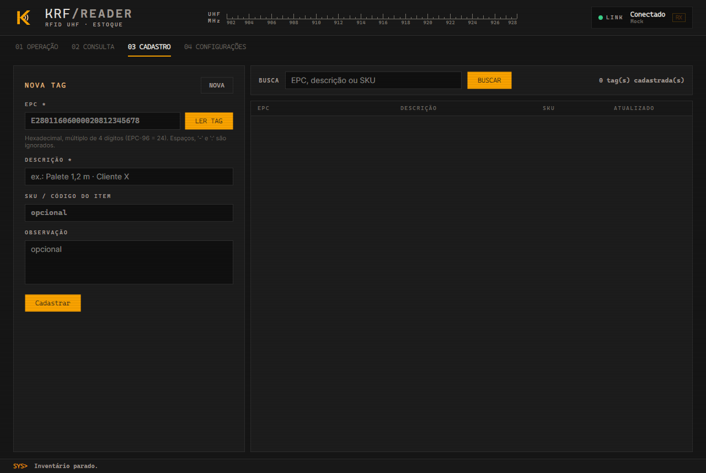
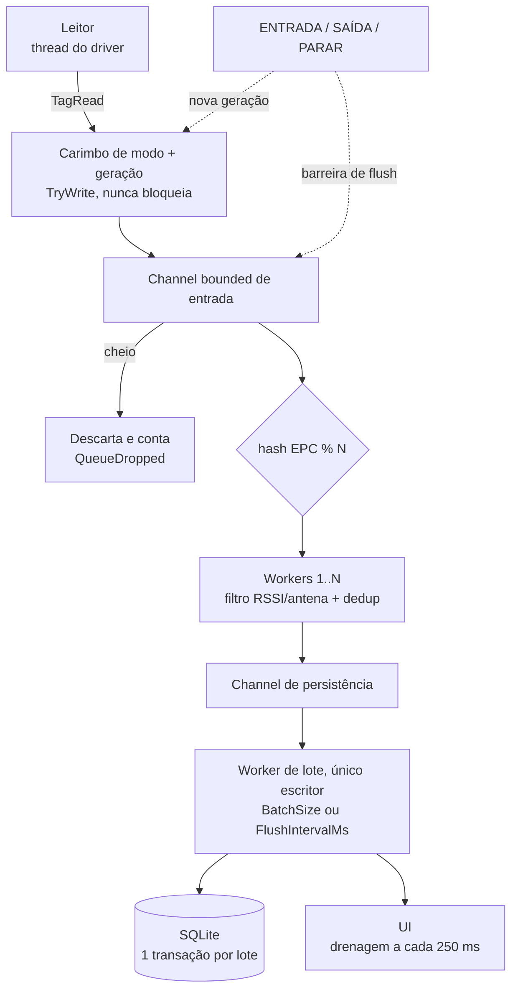

<div align="center">
  

  <h1>《 KRF Reader — Controle de entrada e saída de estoque por RFID UHF 》</h1>

  <p>Aplicação desktop em C# / .NET 8 com interface Avalonia 11. Lê tags RFID UHF num portal (doca, porta de almoxarifado), aplica a direção escolhida pelo operador e mantém o status de cada tag em SQLite. O driver do leitor é desacoplado do fabricante.</p>

  <p>
    
    
    
    
    
    
  </p>
</div>

> [!WARNING]
> O app não tem modo simulado: ele sobe conectando no leitor **R200** (COM3, 115200, 915–928 MHz). Com o R200 real
> foram validados identificação, potência, região/canais, início e parada do inventário. **A leitura de tags com
> hardware real nunca foi validada**: o leitor foi testado sem antena. O pipeline foi coberto por 199 testes
> automatizados, que usam um simulador que só existe no projeto de testes.
> UHF lê fora da zona de interesse; o software mitiga leituras fantasma, mas não resolve. Leia
> [Limitações físicas do UHF](#limitações-físicas-do-uhf) antes de instalar.

## Sumário

- [Sobre o Repositório](#sobre-o-repositório)
- [Módulos](#módulos)
  - [Mapa do código](#mapa-do-código)
- [Projeto](#projeto)
  - [Interface gráfica](#interface-gráfica)
  - [Regras de negócio](#regras-de-negócio)
  - [Cadastro de tags](#cadastro-de-tags)
  - [Pipeline de leituras](#pipeline-de-leituras)
  - [Leitor real](#leitor-real)
  - [Novo driver](#novo-driver)
  - [Trocar o banco](#trocar-o-banco)
  - [Limitações físicas do UHF](#limitações-físicas-do-uhf)
- [Tecnologias](#tecnologias)
- [Como Rodar](#como-rodar)
  - [Requisitos](#requisitos)
  - [Build, testes e publish](#build-testes-e-publish)
  - [Configuração](#configuração)
  - [Testes](#testes)
  - [Contribuição](#contribuição)
- [Decisões e Desafios](#decisões-e-desafios)

## Sobre o Repositório

O **KRF Reader** controla entrada e saída de estoque num portal RFID UHF. O operador escolhe a direção do fluxo:

- **ENTRADA:** toda tag lida fica `DENTRO`.
- **SAÍDA:** toda tag lida fica `FORA`.
- **PARAR:** encerra o inventário e grava o que já foi lido no modo vigente.

A tag carrega apenas o EPC. Toda a lógica de estoque fica no sistema e no banco. Não há servidor, nuvem ou
telemetria: o app fala só com o leitor (serial ou TCP) e com o SQLite local.

## Módulos

| Módulo | Entrega | Descrição |
| --- | --- | --- |
| Interface | `KrfReader.UI` | Avalonia 11 (MVVM): abas Operação, Consulta, Cadastro e Configuração. Composition root e `appsettings.json`. |
| Domínio | `KrfReader.Domain` | Regra pura (`InventoryRules.Decide`, `TagRegistrationRules`), enums, `TagRead`, `Epc`. Sem dependências. |
| Aplicação | `KrfReader.Application` | Contratos (`IRfidReader`, `IReaderProtocol`, `IInventoryRepository`, `ITagCatalogRepository`, `IInventoryPipeline`), options e pipeline concorrente. |
| Infraestrutura | `KrfReader.Infrastructure` | Drivers de leitor (Serial, TCP), protocolos plugáveis e repositório SQLite. |
| Testes | `tests/KrfReader.Tests` | xUnit: domínio, dedup, troca de modo, idempotência, anomalia, SQLite, parser, ponta a ponta. |

### Mapa do código

```text
KRF-Reader/
├── KrfReader.sln
├── Directory.Build.props              # net8.0, nullable, implicit usings
├── Directory.Packages.props           # versões centralizadas (Avalonia 11.3.22, Dapper, Sqlite)
├── db/schema.sql                      # schema (também embutido e aplicado no start)
├── docs/screenshots/                  # telas usadas neste README
├── src/
│   ├── KrfReader.Domain/              # InventoryRules, TagRegistration, Epc, TagRead, TagState, InventoryEvent, DbLiterals
│   ├── KrfReader.Application/
│   │   ├── Configuration/             # ReaderOptions, PipelineOptions, DatabaseOptions
│   │   ├── Persistence/               # IInventoryRepository, ITagCatalogRepository
│   │   ├── Pipeline/                  # InventoryPipeline, Deduplicator, ReadFilter, ModeState
│   │   └── Readers/                   # IRfidReader, IReaderProtocol, IRfidReaderFactory
│   ├── KrfReader.Infrastructure/
│   │   ├── Persistence/               # SqliteInventoryRepository (Dapper, upsert em lote; cadastro em .Catalog.cs)
│   │   └── Readers/                   # GenericSerialReader, GenericTcpReader, Protocols/ (R200/M100, R2000, AsciiLine)
│   └── KrfReader.UI/                  # App, MainWindow, ViewModels, CompositionRoot, Assets
└── tests/KrfReader.Tests/             # Domain, Pipeline, Persistence, Readers, Integration, Fakes
```

| Arquivo | Responsabilidade |
| --- | --- |
| [Domain/InventoryRules.cs](src/KrfReader.Domain/InventoryRules.cs) | Decide o novo status e o evento a partir do status atual e do modo. Função pura. |
| [Domain/Epc.cs](src/KrfReader.Domain/Epc.cs) | Normaliza e valida o EPC. |
| [Domain/TagRegistration.cs](src/KrfReader.Domain/TagRegistration.cs) | Cadastro de tag e validação (EPC Gen2, descrição obrigatória). |
| [Pipeline/InventoryPipeline.cs](src/KrfReader.Application/Pipeline/InventoryPipeline.cs) | Channels de entrada e persistência, workers particionados por EPC, lote, barreira de PARAR e shutdown. |
| [Pipeline/ModeState.cs](src/KrfReader.Application/Pipeline/ModeState.cs) | Modo atual e geração; carimba cada leitura na chegada. |
| [Pipeline/Deduplicator.cs](src/KrfReader.Application/Pipeline/Deduplicator.cs) | Ignora a mesma tag na mesma geração dentro de `DedupWindowSeconds`. |
| [Pipeline/ReadFilter.cs](src/KrfReader.Application/Pipeline/ReadFilter.cs) | Filtro de RSSI mínimo e antenas aceitas. |
| [Readers/StreamRfidReaderBase.cs](src/KrfReader.Infrastructure/Readers/StreamRfidReaderBase.cs) | Base de serial/TCP: transporte, reconexão e threading. |
| [Readers/Protocols/AsciiLineProtocol.cs](src/KrfReader.Infrastructure/Readers/Protocols/AsciiLineProtocol.cs) | Parser `EPC,RSSI,ANTENA[,TIMESTAMP]` com frames parciais. |
| [Fakes/MockReader.cs](tests/KrfReader.Tests/Fakes/MockReader.cs) | Simulador usado só nos testes: população de tags, entrada e saída do campo, rajadas e leituras fantasma. |
| [Persistence/SqliteInventoryRepository.cs](src/KrfReader.Infrastructure/Persistence/SqliteInventoryRepository.cs) | Aplica o lote numa transação: carrega estado, decide, faz upsert e insere eventos. |
| [Persistence/SqliteInventoryRepository.Catalog.cs](src/KrfReader.Infrastructure/Persistence/SqliteInventoryRepository.Catalog.cs) | CRUD de `TagCadastro` e consulta com descrição/SKU. |
| [UI/CompositionRoot.cs](src/KrfReader.UI/CompositionRoot.cs) | Monta configuração, factories, repositório e pipeline. |

## Projeto

### Interface gráfica

<div align="center">
  
  <br/><sub>Operação: modo ativo, contadores, leituras ao vivo e anomalias</sub>
  <br/><br/>
  
  <br/><sub>Consulta por EPC, descrição ou SKU</sub>
  <br/><br/>
  
  <br/><sub>Cadastro de tags: manual ou lendo a tag no leitor</sub>
  <br/><br/>
  
  <br/><sub>Configuração do leitor e do filtro de leituras</sub>
</div>

<br/>

**OPERAÇÃO.** Botões ENTRADA, SAÍDA e PARAR. Mostra o modo ativo, o status do leitor, os contadores (tags dentro, tags fora, lidas nesta sessão) e as últimas 200 leituras aplicadas, com EPC, antena, RSSI e resultado. Saída aparece em vermelho; anomalias (saída sem entrada) ficam num painel separado.

**CONSULTA.** Busca por trecho de EPC, descrição ou SKU. Mostra descrição do cadastro, status atual, última leitura e última mudança de cada tag.

**CADASTRO.** Cadastra tags com descrição, SKU e observação, digitando o EPC ou lendo a tag no leitor. Detalhes em [Cadastro de tags](#cadastro-de-tags).

**CONFIGURAÇÃO.** Duas partes:

- *Leitor RFID*: tipo (Serial, Tcp), porta serial e baud, host e porta TCP, protocolo, potência e antenas ativas. Só vale após **Aplicar leitor**, que desconecta e reconecta. Exige modo PARADO.
- *Filtro de leituras*: RSSI mínimo e antenas aceitas. Vale na hora, sem reconectar.

Fechar a janela com modo ativo grava as leituras pendentes antes de sair ("Encerrando...").

Saída usa vermelho; o laranja do tema é reservado a destaque.

Instrumentos da aba Operação: escala UHF com a faixa do leitor, osciloscópio com o histórico real de leituras/s dos últimos 12 s, mostrador de leituras/s brutas e medidor de RSSI com a marca do RSSI mínimo do filtro. Os mesmos dados alimentam o medidor da aba Configurações.

### Regras de negócio

| Status atual | Modo | Resultado | Evento gravado |
|---|---|---|---|
| (inexistente) | ENTRADA | DENTRO | `CRIACAO` |
| (inexistente) | SAÍDA | FORA | `SAIDA_SEM_ENTRADA` (**anomalia**) |
| FORA | ENTRADA | DENTRO | `MUDANCA_STATUS` |
| DENTRO | SAÍDA | FORA | `MUDANCA_STATUS` |
| DENTRO | ENTRADA | DENTRO | nenhum, só atualiza `UltimaLeitura` (idempotente) |
| FORA | SAÍDA | FORA | nenhum, só atualiza `UltimaLeitura` (idempotente) |

- `Eventos` guarda (EPC, modo, tipo, timestamp, antena, RSSI) de toda mudança de estado e anomalia. `Tags` é a projeção do estado atual, atualizada **na mesma transação** que o evento.
- **Deduplicação**: a mesma tag na mesma *sessão de modo* dentro de `DedupWindowSeconds` é ignorada antes de chegar ao banco. A chave usa a geração, e não apenas o modo. Com uma chave só por modo, ENTRADA → SAÍDA → ENTRADA em menos de N segundos faria a segunda entrada ser ignorada.

### Cadastro de tags

Aba **Cadastro**: associa ao EPC uma descrição (obrigatória), SKU e observação. Tabela `TagCadastro`, separada de `Tags`.

- **Manual**: digite o EPC. Aceita espaços, `-` e `:`; exige hex com tamanho múltiplo de 4 dígitos (palavras de 16 bits do Gen2), de 4 a 124. EPC-96 = 24 dígitos.
- **Ler tag**: liga o leitor por 1,5 s com o inventário **PARADO**, aplica o mesmo filtro de RSSI/antena e preenche o EPC de maior RSSI. Se houver mais de uma tag no campo, todas aparecem para escolha. Nada é gravado em `Tags`/`Eventos`. ENTRADA/SAÍDA ficam bloqueados durante a captura, e a captura é recusada com modo ativo.
- EPC já cadastrado abre em edição. Remover o cadastro **não** apaga status nem histórico da tag.
- Na **Consulta**, cada tag mostra a descrição (ou "não cadastrada"), a busca casa EPC, descrição ou SKU, e "Cadastro desta tag" abre a tag selecionada na aba Cadastro.

**O cadastro não altera a regra de estoque.** Tag cadastrada e nunca lida em ENTRADA, quando lida em SAÍDA, continua sendo `SAIDA_SEM_ENTRADA`; tag não cadastrada lida em ENTRADA continua sendo criada como DENTRO. Ver [Decisões e Desafios](#decisões-e-desafios).

### Pipeline de leituras



- **Geração de modo.** Cada troca de modo (ou PARAR) incrementa um contador de geração. Toda leitura é carimbada com o modo e a geração **no instante em que chega do leitor**. Item com geração antiga é descartado em qualquer estágio (fila, worker, buffer de lote). Por isso uma leitura antiga nunca recebe o modo novo.
- **PARAR** usa uma *barreira de flush*: um marcador percorre fila → workers → persistência, e o lote pendente da geração atual é gravado antes de o modo virar "parado".
- **Shutdown** (fechar a janela): para o leitor, completa os channels em cascata, drena, persiste e encerra com timeout (`ShutdownTimeoutMs`).

### Leitor real

1. Descubra no manual o meio físico (RS-232/USB-serial, TCP, ou SDK) e o protocolo (LLRP, proprietário binário/ASCII).
2. Se o leitor fala **ASCII por linha** (`EPC,RSSI,ANTENA[,TIMESTAMP]`), basta configurar `Reader.Type` = `Serial`/`Tcp` com `Protocol` = `AsciiLine`.
3. Ajuste `PowerDbm` e `Antennas`. Depois, com tags posicionadas **na borda da zona de interesse** e **logo fora dela**, observe o RSSI na lista ao vivo e calibre `MinRssi` entre os dois valores.

### Novo driver

Existem dois pontos de extensão, conforme o caso:

**A. Protocolo proprietário sobre serial/TCP.** Reaproveita transporte, reconexão e threading.

```csharp
public sealed class AcmeBinaryProtocol : IReaderProtocol
{
    public string Name => "AcmeBinary";
    public IReadOnlyList<TagRead> Feed(ReadOnlySpan<byte> data, DateTime receivedAtUtc) { /* framing + CRC */ }
    public IReadOnlyList<byte[]> BuildConfigureCommands(double powerDbm, IReadOnlyCollection<int> antennas) { ... }
    public byte[] BuildStartInventoryCommand() { ... }
    public byte[] BuildStopInventoryCommand() { ... }
    public void Reset() { /* descarta bytes parciais */ }
}

// composition root
protocolFactory.Register("AcmeBinary", () => new AcmeBinaryProtocol());
```

Depois disso, basta usar `"Protocol": "AcmeBinary"` no appsettings. `Feed` é stateful: guarda os bytes de frames incompletos entre as chamadas. Cada conexão recebe uma instância nova.

**B. SDK do fabricante ou LLRP.** Implementa `IRfidReader` diretamente:

1. Crie `AcmeSdkReader : IRfidReader` em `Infrastructure/Readers/`. Converta o callback do SDK em `TagRead` com `Epc.Normalize` e timestamp **UTC** e dispare o evento `TagRead` sem bloquear, porque o pipeline só faz `TryWrite`.
2. Garanta o contrato: métodos idempotentes, e `StopInventoryAsync` só retorna quando o SDK parou de entregar leituras.
3. Adicione um valor em `ReaderType` e um `case` em `RfidReaderFactory.Create`.

O resto (pipeline, banco, UI) não muda.

### Trocar o banco

Implemente `IInventoryRepository` (ex.: `PostgresInventoryRepository`) e escolha pela `Database.Provider` no composition root. O algoritmo de `ApplyBatchAsync` (carregar estado → `InventoryRules.Decide` → upsert → inserir eventos, numa transação) é o mesmo:

- PostgreSQL: `INSERT ... ON CONFLICT (EpcId) DO UPDATE`, igual ao SQLite. Para lotes grandes, use `COPY` para uma tabela temporária e depois `INSERT ... SELECT`.
- SQL Server: `MERGE` ou TVP + `MERGE`. Use `DATETIME2` e `IDENTITY`.

Notas de tipo estão em `db/schema.sql`.

### Limitações físicas do UHF

- **Leituras fantasma.** Um leitor de ~20 m lê tags fora da zona de interesse: prateleira vizinha, pallet parado ao lado da doca, reflexão em metal. Em modo SAÍDA, isso marca como FORA uma tag que nunca saiu. **O software mitiga, mas não resolve.** As mitigações, em ordem de eficácia:
  1. **Geometria da antena**: antena direcional (polarização circular, feixe estreito) apontada para o portal, longe de estoque parado.
  2. **Potência** (`PowerDbm`): reduza até cobrir só o portal. Alcance de 20 m quase nunca é desejável numa doca.
  3. **Blindagem/absorvedores** e distância entre portais de docas adjacentes.
  4. **Filtro de RSSI** (`MinRssi`) e de antena (`AllowedAntennas`). O RSSI varia com orientação da tag, material (líquido e metal atenuam muito) e multipercurso, então o limiar é estatístico e não uma fronteira exata.
- **Sem direção.** Um portal com uma antena não sabe se a tag está entrando ou saindo. Por isso a direção vem do operador (botões). Para automatizar, use duas antenas em sequência (ordem de leitura A→B) ou sensores de presença ou barreira. Isso fica fora do escopo atual.
- **Leituras perdidas.** Tags sobre metal ou líquido, tags sobrepostas no pallet e tags desalinhadas com a polarização podem não ser lidas. Não existe garantia de 100% de leitura. Faça a conciliação periódica com inventário cíclico.
- **Troca de modo.** Um lote que já está dentro da transação no instante do clique termina com o modo em que as leituras chegaram, que é o correto. Na troca, as leituras pendentes da geração anterior são **descartadas** (requisito). O carimbo é feito na chegada ao host. Leituras que estavam no buffer interno do leitor no instante do clique chegam depois e recebem o modo novo. Evite trocar de modo com carga passando pelo portal.
- **Relógio.** O timestamp vem do host em UTC, salvo quando o protocolo envia um timestamp próprio. Sincronize o relógio do leitor (NTP) se ele for usado.

## Tecnologias

| Camada | Tecnologia |
| --- | --- |
| Linguagem e runtime | C# (`LangVersion` latest), .NET 8, `Nullable` |
| Interface | Avalonia 11.3 (Fluent, fonte Inter) + CommunityToolkit.Mvvm 8.4 |
| Persistência | SQLite (Microsoft.Data.Sqlite 8.0) + Dapper 2.1 |
| Leitor | System.IO.Ports 8.0 (serial), `TcpClient` (rede), protocolos plugáveis |
| Concorrência | `System.Threading.Channels` (bounded) |
| Configuração | Microsoft.Extensions.Configuration (JSON) + DependencyInjection + Logging |
| Testes | xUnit 2.9 + Microsoft.Extensions.TimeProvider.Testing |
| Distribuição | `dotnet publish` single-file, self-contained |

## Como Rodar

### Requisitos

* .NET 8 SDK para compilar. O executável publicado é *self-contained*, sem runtime instalado.
* Windows, Linux ou macOS.
* Leitor físico obrigatório: o app sobe tentando o R200 na COM3. Sem leitor, mostra o erro na barra de status; conecte o leitor e use **Aplicar leitor** na aba Configuração.

### Build, testes e publish

```bash
git clone https://github.com/GZimbra/KRF-Reader.git && cd KRF-Reader
dotnet run  --project src/KrfReader.UI        # conecta no R200 (COM3)
dotnet test KrfReader.sln                     # 199 casos de teste, sem hardware e sem rede
dotnet publish src/KrfReader.UI -c Release -r win-x64   --self-contained -p:PublishSingleFile=true -o publish/win-x64
dotnet publish src/KrfReader.UI -c Release -r linux-x64 --self-contained -p:PublishSingleFile=true -o publish/linux-x64
```

Com o leitor conectado: clique em **ENTRADA**, passe as tags e veja os contadores mudarem, depois **PARAR**. O banco
`krf-reader.db` é criado no diretório de execução, com o schema aplicado no start (manual:
`sqlite3 krf-reader.db < db/schema.sql`). Em produção, aponte `Database.ConnectionString` para um caminho absoluto
com permissão de escrita. `appsettings.json` já vai na saída do publish.

### Configuração

Fontes (a última vence): `src/KrfReader.UI/appsettings.json` → `appsettings.Local.json` ao lado do executável
(ignorado pelo git). Tudo é lido no start, sem recompilar. Leitor, porta e potência também mudam na aba
**Configuração** (*Aplicar leitor* recria a conexão); RSSI mínimo e antenas do filtro valem na hora.

| Seção | Chave | Significado |
|---|---|---|
| `Reader` | `Model` | Perfil do catálogo (padrão `r200`) |
| | `Type` | `Serial` ou `Tcp` |
| | `Protocol` | Protocolo registrado para Serial/Tcp (padrão `R200`) |
| | `Serial.PortName` / `BaudRate` / `DataBits` / `Parity` / `StopBits` | Porta serial |
| | `Tcp.Host` / `Port` / `ConnectTimeoutMs` | Leitor em rede |
| | `PowerDbm` | Potência de transmissão (0–33 dBm). É o principal controle de alcance. |
| | `Antennas` | Portas de antena ativas no leitor |
| | `ReconnectDelayMs` | Espera entre tentativas de reconexão automática |
| `Pipeline` | `DedupWindowSeconds` | Janela de deduplicação |
| | `MinRssi` | RSSI mínimo aceito (dBm). Filtro de leitura fantasma. |
| | `AllowedAntennas` | Antenas aceitas pelo filtro (`[]` = todas) |
| | `WorkerCount` | Workers de filtro/dedup |
| | `QueueCapacity` | Capacidade da fila de entrada |
| | `BatchSize` / `FlushIntervalMs` | Gatilhos do lote de gravação |
| | `ShutdownTimeoutMs` | Tempo máximo de drenagem no encerramento |
| `Database` | `Provider` / `ConnectionString` | Hoje só `Sqlite` |

### Testes

| Pasta | Cobre |
|---|---|
| `Domain/` | `InventoryRules.Decide` (tabela completa), normalização de EPC, validação do cadastro, literais do banco |
| `Pipeline/` | Deduplicação por geração, filtro RSSI/antena, troca de modo, barreira de PARAR, shutdown, concorrência do estado de modo, captura para cadastro |
| `Persistence/` | `SqliteInventoryRepository` contra SQLite real: criação, mudança de status, idempotência, anomalia, lote de 2000 leituras, consultas, cadastro de tags e migração de banco antigo |
| `Readers/` | Parser `AsciiLine` (frames parciais, lixo), factory de protocolos, MockReader (fake de teste) |
| `Integration/` | Ponta a ponta: leitor fake → pipeline → SQLite |

### Contribuição

1. Crie um branch a partir de `main`.
2. Dependências apontam para dentro: `Domain` ← `Application` ← `Infrastructure` ← `UI`. `Domain` não referencia nada.
3. Driver novo entra em `Infrastructure/Readers/` e é registrado no composition root; nada fora disso muda.
4. Toda regra nova vem com teste. `dotnet test` precisa passar antes do PR.
5. Configuração local fica em `appsettings.Local.json`, nunca no `appsettings.json` versionado.

## Decisões e Desafios

<details>
<summary><b>Avalonia em vez de WPF</b></summary>

<br/>

WPF só compila e roda em Windows. Avalonia roda em Windows, Linux e macOS e permitiu compilar e testar em Linux. A UI
é MVVM pura, então portar para WPF custa só XAML.

</details>

<details>
<summary><b>Histórico só de mudanças de estado</b></summary>

<br/>

"Todo evento no histórico" combinado com "releitura não gera evento" só é consistente se o histórico for de mudanças
de estado. Registrar toda leitura deduplicada geraria 1 linha a cada `DedupWindowSeconds` por tag parada no campo, o
mesmo flood que a deduplicação deveria evitar. A última leitura fica em `Tags.UltimaLeitura`.

</details>

<details>
<summary><b>Deduplicação por geração, não por modo</b></summary>

<br/>

Com chave só por modo, ENTRADA → SAÍDA → ENTRADA em menos de `DedupWindowSeconds` faria a segunda entrada ser
ignorada. A chave é (EPC, geração do modo), e a geração muda a cada clique.

</details>

<details>
<summary><b>Descarte das pendentes na troca de modo</b></summary>

<br/>

Como cada leitura já carrega o próprio modo, seria seguro persistir o pendente da geração anterior com o modo dela.
O descarte perde leituras válidas feitas logo antes do clique. Foi mantido por ser requisito explícito e é trivial de
mudar em `InventoryPipeline`.

</details>

<details>
<summary><b>Upsert em lote numa transação com Dapper</b></summary>

<br/>

No SQLite, executar o mesmo comando preparado N vezes dentro de uma transação é a forma mais rápida de fazer upsert.
Não há ganho real em montar um `VALUES` multi-linha. Um único escritor elimina contenção de lock no arquivo.

</details>

<details>
<summary><b>Cadastro fora da regra de transição</b></summary>

<br/>

`TagCadastro` não tem FK com `Tags` e não entra em `InventoryRules.Decide`. Duas mudanças possíveis, não implementadas
por mudarem o comportamento em operação: (a) bloquear ou sinalizar como anomalia tag **não cadastrada** lida em ENTRADA
(exige novo `Tipo` em `Eventos`, cujo `CHECK` obriga recriar a tabela no SQLite); (b) cadastrar já com status inicial
DENTRO, para que a primeira SAÍDA de tag cadastrada vire `MUDANCA_STATUS`. Esta última falsifica `UltimaLeitura` (a tag
nunca foi lida) e por isso foi evitada.

</details>

<details>
<summary><b>Validado sem leitor físico</b></summary>

<br/>

O pipeline, o banco e os parsers foram testados com leitores fake e SQLite real. Com o R200 físico, a comunicação foi
validada, mas a leitura de tags não (sem antena). Ao instalar a antena, o primeiro passo é confirmar a leitura e
calibrar `PowerDbm` e `MinRssi` no portal real.

</details>
