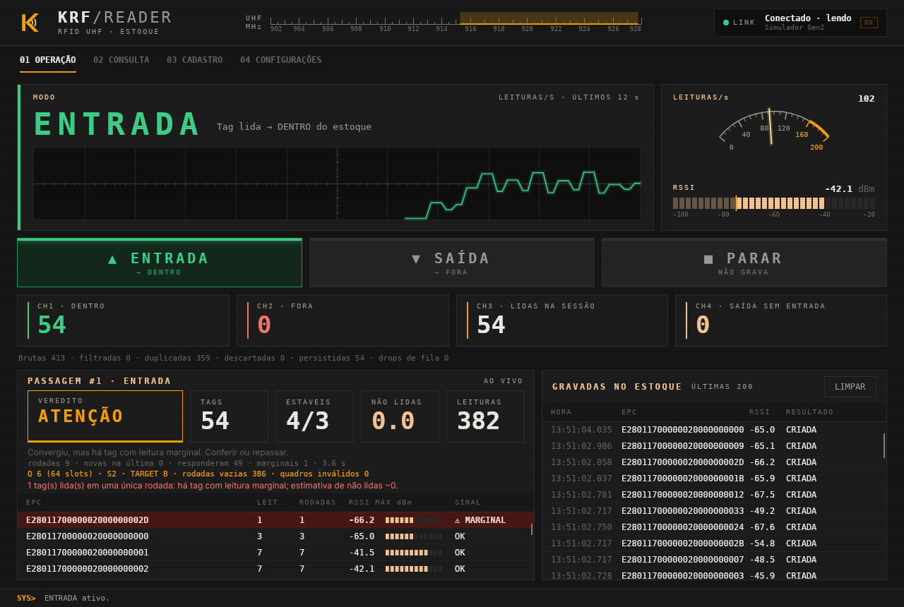
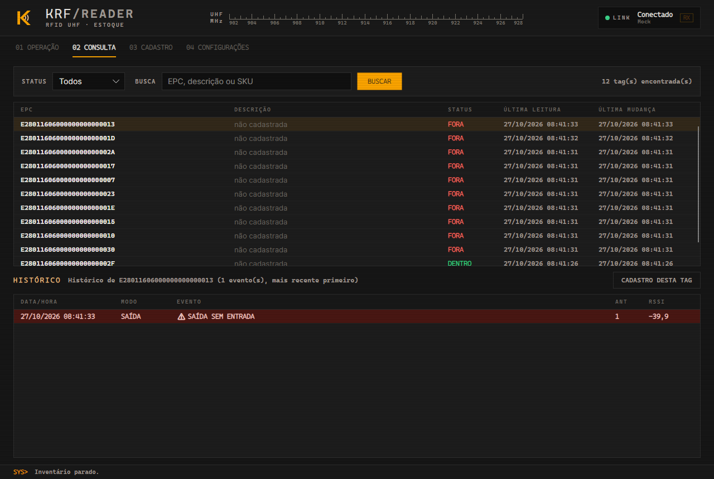
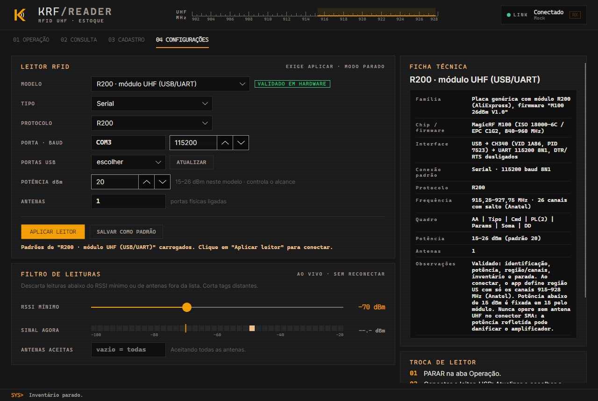

<p align="center">
  
</p>

<p align="center">
  <strong>Controle de entrada e saída de estoque por RFID UHF.</strong><br>
  Aplicação desktop em .NET 8 + Avalonia 11, com SQLite e driver de leitor desacoplado do fabricante.
</p>

<p align="center">
  
  
  
  
</p>

---

O KRF Reader lê tags RFID UHF num portal (doca, porta de almoxarifado) e mantém o status de cada tag no banco. O operador escolhe a direção do fluxo:

- **ENTRADA** ativo: toda tag lida fica `DENTRO`.
- **SAÍDA** ativo: toda tag lida fica `FORA`.
- **PARAR**: encerra o inventário e grava o que já foi lido no modo vigente.

A tag carrega apenas o EPC. Toda a lógica de estoque fica no sistema e no banco.

## Sumário

- [Telas](#telas)
- [Início rápido](#início-rápido)
- [Uso](#uso)
- [Configuração](#configuração-srckrfreaderuiappsettingsjson)
- [Regras de negócio](#regras-de-negócio-implementadas)
- [Arquitetura](#arquitetura)
- [Leitor real e novos drivers](#como-configurar-o-leitor-real)
- [Trocar o banco](#trocar-o-banco-sql-server--postgresql)
- [Limitações físicas do UHF](#limitações-físicas-do-uhf-leia-antes-de-instalar)
- [Decisões de arquitetura](#decisões-de-arquitetura)
- [Testes](#testes)
- [Publicação](#publicação)
- [Contribuição](#contribuição)

## Telas

| Operação | Consulta | Configuração |
|---|---|---|
|  |  |  |

## Início rápido

Requisito: [.NET 8 SDK](https://dotnet.microsoft.com/download/dotnet/8.0). Não precisa de leitor físico.

```bash
git clone https://github.com/GZimbra/KRF-Reader.git
cd KRF-Reader
dotnet run --project src/KrfReader.UI
```

O app sobe com o **MockReader**, um simulador com população de tags, tags entrando e saindo do campo, rajadas de releitura e leituras fantasma de RSSI baixo. Clique em **ENTRADA**, veja as leituras chegarem e os contadores mudarem, depois **PARAR**.

O banco SQLite (`krf-reader.db`) é criado no diretório de execução, com o schema aplicado no start. Para criar manualmente: `sqlite3 krf-reader.db < db/schema.sql`.

## Uso

**OPERAÇÃO.** Botões ENTRADA, SAÍDA e PARAR. Mostra o modo ativo, o status do leitor, os contadores (tags dentro, tags fora, lidas nesta sessão) e as últimas 200 leituras aplicadas, com EPC, antena, RSSI e resultado. Saída aparece em vermelho; anomalias (saída sem entrada) ficam num painel separado.

**CONSULTA.** Busca por trecho de EPC. Mostra status atual, última leitura e última mudança de cada tag.

**CONFIGURAÇÃO.** Duas partes:

- *Leitor RFID*: tipo (Mock, Serial, Tcp), porta serial e baud, host e porta TCP, protocolo, potência e antenas ativas. Só vale após **Aplicar leitor**, que desconecta e reconecta. Exige modo PARADO.
- *Filtro de leituras*: RSSI mínimo e antenas aceitas. Vale na hora, sem reconectar.

Fechar a janela com modo ativo grava as leituras pendentes antes de sair ("Encerrando...").

## Configuração (`src/KrfReader.UI/appsettings.json`)

Tudo é lido no start, sem recompilar. Para sobrescrever localmente sem versionar, crie `appsettings.Local.json` ao lado do executável.

| Seção | Chave | Significado |
|---|---|---|
| `Reader` | `Type` | `Mock`, `Serial` ou `Tcp` |
| | `Protocol` | Protocolo registrado para Serial/Tcp (padrão `AsciiLine`) |
| | `Serial.PortName` / `BaudRate` / `DataBits` / `Parity` / `StopBits` | Porta serial |
| | `Tcp.Host` / `Port` / `ConnectTimeoutMs` | Leitor em rede |
| | `PowerDbm` | Potência de transmissão (0–33 dBm). É o principal controle de alcance. |
| | `Antennas` | Portas de antena ativas no leitor |
| | `ReconnectDelayMs` | Espera entre tentativas de reconexão automática |
| `Pipeline` | `DedupWindowSeconds` | Janela de deduplicação |
| | `MinRssi` | RSSI mínimo aceito (dBm). Filtro de leitura fantasma. |
| | `AllowedAntennas` | Antenas aceitas pelo filtro (`[]` = todas) |
| | `WorkerCount` | Workers de filtro/dedup |
| | `QueueCapacity` | Capacidade da fila de entrada |
| | `BatchSize` / `FlushIntervalMs` | Gatilhos do lote de gravação |
| | `ShutdownTimeoutMs` | Tempo máximo de drenagem no encerramento |
| `Database` | `Provider` / `ConnectionString` | Hoje só `Sqlite` |

Leitor, porta e potência também podem ser trocados na aba **Configuração**, com "Aplicar leitor", que recria a conexão. O RSSI mínimo e as antenas do filtro valem na hora.

## Regras de negócio implementadas

| Status atual | Modo | Resultado | Evento gravado |
|---|---|---|---|
| (inexistente) | ENTRADA | DENTRO | `CRIACAO` |
| (inexistente) | SAÍDA | FORA | `SAIDA_SEM_ENTRADA` (**anomalia**) |
| FORA | ENTRADA | DENTRO | `MUDANCA_STATUS` |
| DENTRO | SAÍDA | FORA | `MUDANCA_STATUS` |
| DENTRO | ENTRADA | DENTRO | nenhum, só atualiza `UltimaLeitura` (idempotente) |
| FORA | SAÍDA | FORA | nenhum, só atualiza `UltimaLeitura` (idempotente) |

- `Eventos` guarda (EPC, modo, tipo, timestamp, antena, RSSI) de toda mudança de estado e anomalia. `Tags` é a projeção do estado atual, atualizada **na mesma transação** que o evento.
- **Deduplicação**: a mesma tag na mesma *sessão de modo* dentro de `DedupWindowSeconds` é ignorada antes de chegar ao banco. A chave usa a geração, e não apenas o modo. Com uma chave só por modo, ENTRADA → SAÍDA → ENTRADA em menos de N segundos faria a segunda entrada ser ignorada.

## Arquitetura

```
src/
  KrfReader.Domain/           Regra pura (InventoryRules.Decide), enums, TagRead, Epc. Sem dependências.
  KrfReader.Application/      Contratos (IRfidReader, IReaderProtocol, IInventoryRepository, IInventoryPipeline),
                              Options e o pipeline concorrente (InventoryPipeline, Deduplicator, ReadFilter, ModeState).
  KrfReader.Infrastructure/
    Readers/                  MockReader, GenericSerialReader, GenericTcpReader, protocolos plugáveis, factories.
    Persistence/              SqliteInventoryRepository (Dapper, upsert em lote).
  KrfReader.UI/               Avalonia 11 (MVVM), composition root, appsettings.json.
tests/KrfReader.Tests/        xUnit: domínio, dedup, troca de modo, idempotência, anomalia, SQLite, parser, ponta a ponta.
db/schema.sql                 Script de criação do banco (também embutido e aplicado no start).
```

### Pipeline de threads

```
 leitor (thread do driver)
   │  evento TagRead → carimba (modo, geração) → TryWrite        [nunca bloqueia o driver]
   ▼
 Channel<T> bounded de entrada  (cheio = descarta e conta "QueueDropped")
   ▼
 dispatcher ── hash(EPC) % N ──► worker 1..N   (filtro RSSI/antena + deduplicação, sem lock por partição)
   ▼
 Channel<T> de persistência
   ▼
 worker de lote (único escritor): acumula até BatchSize ou FlushIntervalMs → 1 transação → BatchPersisted
   ▼
 UI (Dispatcher.UIThread, drenagem a cada 250 ms)
```

- **Geração de modo.** Cada troca de modo (ou PARAR) incrementa um contador de geração. Toda leitura é carimbada com o modo e a geração **no instante em que chega do leitor**. Item com geração antiga é descartado em qualquer estágio (fila, worker, buffer de lote). Por isso uma leitura antiga nunca recebe o modo novo.
- **PARAR** usa uma *barreira de flush*: um marcador percorre fila → workers → persistência, e o lote pendente da geração atual é gravado antes de o modo virar "parado".
- **Shutdown** (fechar a janela): para o leitor, completa os channels em cascata, drena, persiste e encerra com timeout (`ShutdownTimeoutMs`).

## Como configurar o leitor real

1. Descubra no manual o meio físico (RS-232/USB-serial, TCP, ou SDK) e o protocolo (LLRP, proprietário binário/ASCII).
2. Se o leitor fala **ASCII por linha** (`EPC,RSSI,ANTENA[,TIMESTAMP]`), basta configurar `Reader.Type` = `Serial`/`Tcp` com `Protocol` = `AsciiLine`.
3. Ajuste `PowerDbm` e `Antennas`. Depois, com tags posicionadas **na borda da zona de interesse** e **logo fora dela**, observe o RSSI na lista ao vivo e calibre `MinRssi` entre os dois valores.

## Como implementar um novo driver

Existem dois pontos de extensão, conforme o caso:

**A. Protocolo proprietário sobre serial/TCP.** Reaproveita transporte, reconexão e threading.

```csharp
public sealed class AcmeBinaryProtocol : IReaderProtocol
{
    public string Name => "AcmeBinary";
    public IReadOnlyList<TagRead> Feed(ReadOnlySpan<byte> data, DateTime receivedAtUtc) { /* framing + CRC */ }
    public IReadOnlyList<byte[]> BuildConfigureCommands(double powerDbm, IReadOnlyCollection<int> antennas) { ... }
    public byte[] BuildStartInventoryCommand() { ... }
    public byte[] BuildStopInventoryCommand() { ... }
    public void Reset() { /* descarta bytes parciais */ }
}

// composition root
protocolFactory.Register("AcmeBinary", () => new AcmeBinaryProtocol());
```

Depois disso, basta usar `"Protocol": "AcmeBinary"` no appsettings. `Feed` é stateful: guarda os bytes de frames incompletos entre as chamadas. Cada conexão recebe uma instância nova.

**B. SDK do fabricante ou LLRP.** Implementa `IRfidReader` diretamente:

1. Crie `AcmeSdkReader : IRfidReader` em `Infrastructure/Readers/`. Converta o callback do SDK em `TagRead` com `Epc.Normalize` e timestamp **UTC** e dispare o evento `TagRead` sem bloquear, porque o pipeline só faz `TryWrite`.
2. Garanta o contrato: métodos idempotentes, e `StopInventoryAsync` só retorna quando o SDK parou de entregar leituras.
3. Adicione um valor em `ReaderType` e um `case` em `RfidReaderFactory.Create`.

O resto (pipeline, banco, UI) não muda.

## Trocar o banco (SQL Server / PostgreSQL)

Implemente `IInventoryRepository` (ex.: `PostgresInventoryRepository`) e escolha pela `Database.Provider` no composition root. O algoritmo de `ApplyBatchAsync` (carregar estado → `InventoryRules.Decide` → upsert → inserir eventos, numa transação) é o mesmo:

- PostgreSQL: `INSERT ... ON CONFLICT (EpcId) DO UPDATE`, igual ao SQLite. Para lotes grandes, use `COPY` para uma tabela temporária e depois `INSERT ... SELECT`.
- SQL Server: `MERGE` ou TVP + `MERGE`. Use `DATETIME2` e `IDENTITY`.

Notas de tipo estão em `db/schema.sql`.

## Limitações físicas do UHF (leia antes de instalar)

- **Leituras fantasma.** Um leitor de ~20 m lê tags fora da zona de interesse: prateleira vizinha, pallet parado ao lado da doca, reflexão em metal. Em modo SAÍDA, isso marca como FORA uma tag que nunca saiu. **O software mitiga, mas não resolve.** As mitigações, em ordem de eficácia:
  1. **Geometria da antena**: antena direcional (polarização circular, feixe estreito) apontada para o portal, longe de estoque parado.
  2. **Potência** (`PowerDbm`): reduza até cobrir só o portal. Alcance de 20 m quase nunca é desejável numa doca.
  3. **Blindagem/absorvedores** e distância entre portais de docas adjacentes.
  4. **Filtro de RSSI** (`MinRssi`) e de antena (`AllowedAntennas`). O RSSI varia com orientação da tag, material (líquido e metal atenuam muito) e multipercurso, então o limiar é estatístico e não uma fronteira exata.
- **Sem direção.** Um portal com uma antena não sabe se a tag está entrando ou saindo. Por isso a direção vem do operador (botões). Para automatizar, use duas antenas em sequência (ordem de leitura A→B) ou sensores de presença ou barreira. Isso fica fora do escopo atual.
- **Leituras perdidas.** Tags sobre metal ou líquido, tags sobrepostas no pallet e tags desalinhadas com a polarização podem não ser lidas. Não existe garantia de 100% de leitura. Faça a conciliação periódica com inventário cíclico.
- **Troca de modo.** Um lote que já está dentro da transação no instante do clique termina com o modo em que as leituras chegaram, que é o correto. Na troca, as leituras pendentes da geração anterior são **descartadas** (requisito). O carimbo é feito na chegada ao host. Leituras que estavam no buffer interno do leitor no instante do clique chegam depois e recebem o modo novo. Evite trocar de modo com carga passando pelo portal.
- **Relógio.** O timestamp vem do host em UTC, salvo quando o protocolo envia um timestamp próprio. Sincronize o relógio do leitor (NTP) se ele for usado.

## Decisões de arquitetura

- **Avalonia em vez de WPF**: WPF só compila e roda em Windows. Avalonia roda em Windows, Linux e macOS e permitiu compilar e testar em CI Linux. A UI é MVVM pura, então portar para WPF custa só XAML.
- **`Eventos` não registra releitura idempotente.** "Todo evento no histórico" combinado com "releitura não gera evento" só é consistente se o histórico for de mudanças de estado. Registrar toda leitura deduplicada geraria 1 linha a cada `DedupWindowSeconds` por tag parada no campo, ou seja, o mesmo flood que a deduplicação deveria evitar. A última leitura fica em `Tags.UltimaLeitura`.
- **Descarte na troca de modo.** Como cada leitura já carrega o próprio modo, seria seguro persistir o pendente da geração anterior com o modo dela. O descarte perde leituras válidas feitas logo antes do clique. Ele foi mantido por ser requisito explícito e é trivial de mudar em `InventoryPipeline`.
- **Dapper com upsert em lote numa transação.** No SQLite, executar o mesmo comando preparado N vezes dentro de uma transação é a forma mais rápida de fazer upsert. Não existe ganho real em montar um `VALUES` multi-linha.

## Testes

```bash
dotnet test KrfReader.sln
```

90 testes em xUnit (`tests/KrfReader.Tests`), sem hardware e sem rede:

| Pasta | Cobre |
|---|---|
| `Domain/` | `InventoryRules.Decide` (tabela completa), normalização de EPC, literais do banco |
| `Pipeline/` | Deduplicação por geração, filtro RSSI/antena, troca de modo, barreira de PARAR, shutdown, concorrência do estado de modo |
| `Persistence/` | `SqliteInventoryRepository` contra SQLite real: criação, mudança de status, idempotência, anomalia, lote de 2000 leituras, consultas |
| `Readers/` | Parser `AsciiLine` (frames parciais, lixo), factory de protocolos, MockReader |
| `Integration/` | Ponta a ponta: leitor fake → pipeline → SQLite |

## Publicação

Executável autocontido, sem exigir .NET instalado na máquina do operador:

```bash
# Windows
dotnet publish src/KrfReader.UI -c Release -r win-x64 --self-contained -p:PublishSingleFile=true -o publish/win-x64

# Linux
dotnet publish src/KrfReader.UI -c Release -r linux-x64 --self-contained -p:PublishSingleFile=true -o publish/linux-x64
```

Copie `appsettings.json` (já vai na saída) e, se usar, `appsettings.Local.json` para a mesma pasta do executável. O banco é criado no diretório de trabalho do processo: em produção, aponte `Database.ConnectionString` para um caminho absoluto com permissão de escrita.

## Contribuição

1. Crie um branch a partir de `main`.
2. Mantenha as dependências apontando para dentro: `Domain` ← `Application` ← `Infrastructure` ← `UI`. `Domain` não referencia nada.
3. Driver novo entra em `Infrastructure/Readers/` e é registrado no composition root; nada fora disso deve mudar.
4. Toda regra nova vem com teste. `dotnet test` precisa passar antes do PR.
5. Configuração local fica em `appsettings.Local.json` (ignorado pelo git), nunca no `appsettings.json` versionado.
